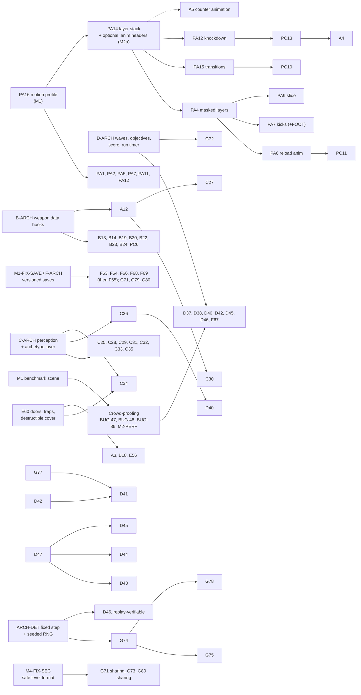
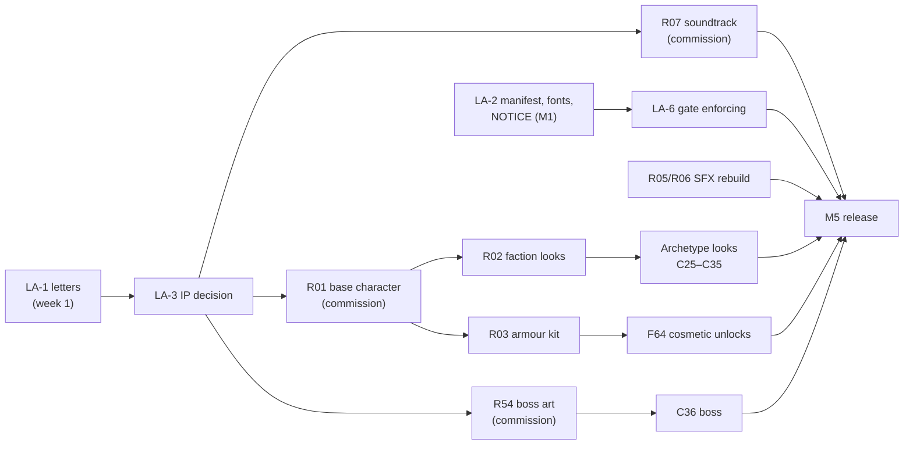

# Insanity Interactive Reloaded: Development Roadmap

**Status:** draft for Zeph's review, written 2026-11-17. Nothing in it is approved, scheduled as decided or committed. Every estimate is a range with a confidence level. None of them is a commitment.

**Basis:** the Phase 1 audit on branch `audit/phase-1` (commit `aa971d7`):
- `docs/TECHNICAL_AUDIT.md`: bugs (`BUG-nn`), performance hotspots (`PERF-nn`), architecture, testing baseline.
- `docs/FEATURE_TRACKER.md`: the 118 feature IDs, the 16 `Proposed` fix-group rows and their proposed milestones.
- `docs/ASSET_REQUIREMENTS.md`: release blockers (`BL-1` … `BL-11`) and asset rows (`R01` … `R97`).
- The "Top improvement candidates" in the six auditor reports in `.superpowers/audit/` (cited as [01] … [06], as in the audit).

**Status words** are the tracker's: Implemented (verified), Implemented (unverified), Partial, Not started, Proposed. Today **no feature is Implemented (verified)**, because Phase 1 was read-only and nobody launched the game.

**Milestone changes.** Where this roadmap moves a feature or fix away from the tracker's proposed milestone, the move is listed under "Changes vs tracker" at the end, so the tracker can be updated to match.

**Assumptions behind every estimate:**
- One developer (Zeph) with AI help, about 5 focused days a week.
- Past velocity is high for well-specified, isolated work. XInput controller support (5 tasks plus a fix wave) landed in one day. Menu navigation, pad rebinding and the rebrand landed the next day. Most of the work below touches shared gameplay code and needs play-testing, and play-testing does not compress the same way.
- "Confidence" means the chance of finishing inside the range.
- Art and music lead times are outside Zeph's control and are tracked separately (section 2 and section 9).

---

## 1. Where the project stands

1. **The code base is healthy enough to build on.** The Debug build succeeds with 0 errors and 110 warnings (13 s, warm). **190 of 191 tests pass.** The one failure is BUG-75, a test-order bug in `HandArmourDeserialiserTest`, not a game bug, and its fix is one line. There is no CI. [01]
2. **Nothing has been verified by playing.** Of the 118 feature IDs:
   - 21 are Implemented (unverified);
   - 49 are Partial;
   - 48 are Not started (36 MISSING, 5 TECH_DIFFICULT, 7 DEPENDENT);
   - 0 are Implemented (verified).
3. **The game cannot be sold as it stands.** The Madness IP, the music, the sound effects and two fonts are release blockers (BL-1 … BL-11; see section 2).
4. **One CPU core runs at 100% for the whole session** (BUG-01, PERF-01). The engine's frame limiter busy-waits, the default cap is 300 fps, VSync is off and the process runs at High priority. The loop is evidenced in the code and in the shipped engine IL. The CPU load itself is inferred, not measured.
5. **Saves are fragile** (BUG-02 … BUG-10):
   - no version fields and no atomic writes;
   - nothing is saved on a crash;
   - `arena.json` is overwritten at every exit;
   - a corrupt campaign file makes the game throw every frame.
6. **Combat is data-driven but has accuracy and responsiveness gaps.** There are 120 weapons in one JSON schema. There is no reload, by design. Melee is a single ray along the cursor that ignores the animated weapon. Only melee buffers input. Five cheap, verified correctness bugs exist: BUG-22, BUG-23, BUG-25, BUG-26 and BUG-44.
7. **Animation is solid but limited.** It is a procedural hop rig with 192 keyframe clips on top. There is no idle motion, no run, no masked layers and no foot channel. [03] proposes a backwards-compatible extension whose defaults reproduce today's output exactly.
8. **The enemy AI is one 718-line system that cheats.** It targets and aims through walls, and every archetype runs the same code. There is one bespoke boss, Rich, who is a Madness character.
9. **Modes are uneven.** Campaign, Incident, Experiment and the tutorial work. Arena is a stub. There are no waves, no scoring and no objectives outside Campaign. Cached level assets are changed at run time, which breaks two disks and Incident (BUG-61 … BUG-63).
10. **Crowds will break things.** Ragdolls fly apart from the 15th simultaneous one (BUG-47). New decals are dropped past 512 (BUG-48). OpenAL sources are suspected to leak past 128 one-shots (BUG-86). The AI runs at the frame rate (PERF-03). Wave modes will hit all four.
11. **Sharing and determinism need groundwork.** A level file can run arbitrary code (BUG-87). Gameplay runs on a variable timestep with an unseeded engine RNG, which blocks replays, verifiable daily runs and fair leaderboards (ARCH-DET).
12. **Controller support is real, and Windows-only.** It is XInput with about 139 unit tests, and Zeph has played it on a real pad (gameplay). The gaps:
    - pad-only players can't collect Improbability disks (BUG-71);
    - there are no deadzone settings and no button glyphs.

---

## 2. The commercial release reality

**Insanity Interactive Reloaded cannot be sold as it stands.**

The GPL-3.0 licence covers the code. It does not cover:
- the Madness Combat characters, setting and name;
- the 44 music tracks;
- the library sound effects;
- two of the fonts.

itch.io's terms (§4) make every seller warrant that they hold the rights to everything they upload. So a paid release needs one of two things for **each** blocker below: **written permission** from the rights holder, or **replacement**. ASSET_REQUIREMENTS.md has the evidence and sources for each row. None of it is legal advice.

| BL | What | Rights holder (best evidence) | Route to a paid release | What it costs |
|---|---|---|---|---|
| BL-1 | Madness characters, looks, factions, most armour, bosses (Rich), 3 campaigns | Matt "Krinkels" Jolly; "MADNESS: Project Nexus" is a trademark of GIBBING TREE, LLC | Written licence (unlikely: it would compete with their paid game), or an original cast and setting (R01–R03) | Art budget: a commissioned base character plus Zeph's SVG kit |
| BL-2 | 59 Madness Combat episode backgrounds (36 MB, unreferenced) | Krinkels | Delete (approval needed) | None |
| BL-3 | Names and trademarks: "Madness", track titles, real gun brands, disk names | Various | Rename (R13) | Zeph's time |
| BL-4 | Studio Minus art, animation, levels and cutscenes (conditional) | Studio Minus | Written confirmation that the GPL covers them and that they don't object to a paid fork; otherwise replace everything visual | Decides the background and sprite budget |
| BL-5 | Music: 44 tracks, none licensed | Several composers, 11 tracks with no author | Permission per composer, or a new soundtrack (R07) | Music budget |
| BL-6 | 14 or more SFX with commercial-library tags | BOOM, PMSFX, Sound Ideas, Sound Pack Tree | Replace (permission is not practical) | Zeph's time, CC0 and Sonniss sources |
| BL-7 | About 274 SFX of unknown origin | Unknown | Replace, unless a transferable licence is documented | Zeph's time |
| BL-8 | Impact font | Monotype | OFL font (R08) | S |
| BL-9 | Toxigenesis font (drives the HUD), plus Tipografia | Typodermic; Tipografia unknown | OFL font (R09); delete Tipografia (approval needed) | S |
| BL-10 | FFmpeg 5.1.2 GPL build shipped without a source offer | FFmpeg and its codec libraries | Publish the source offer now; later an LGPL decoder-only build, or drop video if the cutscenes go | S–M |
| BL-11 | `NOTICE.txt` and credits gaps | — | Generate both from a provenance manifest | S–M |

**Replacement is the likely route, and it is the biggest budget item in the plan.**
- [06] judged a commercial licence for a competing paid game unlikely. ASSET_REQUIREMENTS therefore plans a **total conversion**, and switches back only if written permission arrives.
- The parts that need money or a collaborator:
  - the base character (R01) and the hero armour pieces (R03);
  - the soundtrack (R07) and boss music (R55);
  - boss and heavy-armour art (R54, R48);
  - painted backgrounds for new biomes (R66–R69);
  - store art (R14).
- Market prices are **unverified**. Get three quotes for each.
- **Commission lead times, not code, are the most likely thing to set the release date** (section 9).

**The Studio Minus reply is the biggest swing factor.**
- **If they confirm** that their own art is GPL-3.0 and don't object to a paid fork: the generic backgrounds, weapons, props, FX and clips can be reused (Tier 2 in ASSET_REQUIREMENTS §3). The art bill then shrinks to the cast, the audio and any new biomes.
- **If they don't:** every background and sprite needs replacing, and the launch scope has to shrink or the date has to move.

### 2.1 The Licensing & Assets track (LA), in parallel from day 1

This track runs beside the code milestones. It starts immediately, with steps that delete nothing.

| Step | What | Who | When | Destructive? |
|---|---|---|---|---|
| **LA-1a** | **Write to Studio Minus.** Ask three things: (1) does the repo's GPL-3.0 cover your art, animations, levels and videos; (2) do you object to a paid fork; (3) what are the sources and contacts for the music and SFX? (BL-4, BL-5, BL-7) | Zeph | Week 1 | No |
| **LA-1b** | **Write to Matt "Krinkels" Jolly and to GIBBING TREE, LLC.** Ask for a written, non-exclusive commercial licence for the characters, setting and name (BL-1, BL-3). Plan as if the answer is no. | Zeph | Week 1 | No |
| LA-1c | Optional: write to the composers. Start with Lothyde and MonoCronic, then Mmodule and Meonly70 (BL-5). Don't pursue the "Madness Combat N" tracks, "Chicken Dance" or the uncredited tracks. | Zeph | Weeks 1–2 | No |
| **LA-2** | **Non-destructive hygiene** (M1 work package WP-06): • a provenance manifest, `base/ASSETS.json`, plus a licence-gate test in **report-only** mode, which reports and never fails the build; • `NOTICE.txt` completed (BUG-103, BL-11); • the FFmpeg source offer (BUG-104, BL-10); • OFL fonts swapped in for Impact and Toxigenesis (BL-8, BL-9); • the credits completed (BUG-106). | Zeph + AI | M1 | No. Old files stay in the repo. |
| LA-3 | **IP decision:** permission or total conversion. The default planning assumption is total conversion (section 8, decision 4). | Zeph | When the replies arrive, by the end of M1 at the latest | No (a decision) |
| LA-4 | **Replacement production.** Quotes and contracts for R01, R07 and R14 (and R54 and R48 if a boss and heavies are in the launch scope). Rebuild the SFX (R05, R06) from CC0 and Sonniss. Renames (R13). Asset tooling (ASSET_REQUIREMENTS §6): validator, conversion scripts, SVG rig template. | Zeph, commissioned artists | Quotes in M1; contracts early in M2a; delivery through M3b | No |
| LA-5 | **Compliance builds and quarantine.** An LGPL decoder-only FFmpeg build, or no video at all (BL-10). Hide the Madness looks and armour with the existing `hidden` flag (reversible). | Zeph + AI | After LA-3; by M5 | No (reversible) |
| LA-6 | **Removal, and the gate switched to enforcing.** Release needs zero BL items. | Zeph | M5 | **Yes: every deletion needs Zeph's explicit approval** |

> **Requires Zeph's explicit approval.** None of these is scheduled as decided:
> - deleting the 14 or more library-tagged SFX (BL-6) in a normal commit;
> - **rewriting git history** to remove those files from the public repo. This means a force-push. It breaks existing clones, and it can't recall copies that were already fetched or forked;
> - deleting the 59 Madness Combat backgrounds and `madness_4_party.ogg` (BL-2, BUG-108);
> - deleting Tipografia (BUG-107), the duplicate Roboto Mono (BUG-110), and the Impact and Toxigenesis files after the swap;
> - deleting the music (BL-5), the remaining SFX (BL-7), the cutscene videos (BL-4) and the Madness looks, armour and campaign data (BL-1).

---

## 3. The 10 highest-value improvements

**How the score works:** Score = Value × Urgency ÷ Effort.

| Factor | Scale |
|---|---|
| **Value** | 1–5: direct value to players. For an enabler, it also counts what the enabler unlocks. |
| **Urgency** | 3 = affects every player now, or blocks 5 or more planned features 2 = needed before launch 1 = nice to have |
| **Effort** | The tracker's grades on a log-like scale: S = 1, S–M = 1.5, M = 2, L = 3 |

- Ties go to combat quality first, then stability, performance and replayability.
- The Licensing & Assets track is **not** ranked. It isn't an optional improvement; it's a precondition for selling.

| # | ID | Improvement | Why | V | U | E | Score | Depends on | Milestone |
|---|---|---|---|---|---|---|---|---|---|
| 1 | M1-FIX-PERF (BUG-01, PERF-01) | Sleeping frame limiter as an `IGameLoopEvent`; drop High priority | Every player pays a full core today, menus included. That costs laptop battery, heat and GPU headroom. About 50 lines, with no engine fork. | 4 | 3 | S | **12** | — | M1 |
| 2 | M1-FIX-COMBAT core (BUG-22, BUG-23, BUG-25, BUG-26) + BUG-44 (from M1-FIX-ANIM) | Fix five verified combat bugs | Silent errors players already hit: • a blunt swing that never hits; • stats lost when disks stack; • axes that stick less often than designed; • thrown weapons that ignore god mode; • a hand-scale glitch in blends. | 3 | 3 | S | **9** | — | M1 |
| 3 | M1-FIX-SAVE (BUG-02 … BUG-10; the save half of F-ARCH) | Versioned, atomic, crash-safe saves | Ends lost progress and the campaign that throws every frame. Every progression feature (F61–F70) builds on it. | 4 | 3 | S–M | **8** | — | M1 |
| 4 | PC3 (and PC1) | An input buffer of about 120 ms for fire, jump-dodge, throw and interact | The biggest responsiveness gain. Presses made during cooldowns are lost today. The controls don't change. | 4 | 2 | S | **8** | — | M1 |
| 5 | PC7 (with PERF-04) | Wall impact feedback on every bullet-blocking surface; no `GL.ReadPixels` per bullet hole | Outside DecalZones, shots "vanish into walls". It also removes a likely GPU stall. | 3 | 2 | S | **6** | — | M1 stretch, else M2a |
| 6 | M1-FIX-STAB (BUG-11 … BUG-15) | Crash and load safety | Soft-locks on failed loads, and crash reports that link to a log that is never written. Play-test feedback depends on fixing this. | 2 | 3 | S | **6** | — | M1 |
| 7 | BUG-47 + BUG-48 | Mass-kill robustness: growable ragdoll buffers and a decal ring buffer | Mass kills are core to the genre. From the 15th simultaneous ragdoll, bodies fly apart. Wave modes will hit it. | 3 | 2 | S | **6** | — | M1 (BUG-47), M1 stretch (BUG-48) |
| 8 | PA11 + PC5 | Spring-based hit reactions with per-limb impulses, for NPCs | [03] calls this the biggest combat-feel gain per line of code. It makes reactions directional. | 4 | 2 | S–M | **5.3** | PA16 | M2a |
| 9 | D-ARCH | Waves, objectives, score and a run timer as shared services | One implementation unlocks D37–D47 and G72. It is the backbone of replayability. | 5 | 3 | L | **5** | None in the tracker. Schedule it after BUG-47 and BUG-61 … BUG-63. | M3a |
| 10 | C-ARCH | AI perception, a per-archetype decision layer and a debug overlay | Fair enemies that don't aim through walls, and archetypes that really differ. Unlocks C25–C36. | 5 | 3 | L | **5** | — | M2b |

**Just outside the top 10**, all scored 3–4:
- input settings and BUG-71 (M1-FIX-INPUT, PC16, PC15);
- positional audio (BUG-85);
- the test and CI baseline (M1-FIX-TEST);
- the motion profile (PA16);
- the simulation cost pass (M2-PERF).

All of these except M2-PERF are in M1 anyway. They are cheap foundations that later work needs.

---

## 4. Dependencies and priorities

### 4.1 Key enablers (code)

Notes:
- **D-ARCH plus D47 together open every D-row.** D47 (difficulty modifiers) has no dependency, and D43 and D44 hang off it.
- **The animation stack** is PA16 (in M1), then PA14's layers (in M2a). Together they unlock the PA rows, A4, A5's counter animation, and PC11–PC13.
- **Versioned saves** (M1) unlock the F rows that store progress (F63, F64, F66, F68, F69, and F65 through them). F67 and F70 use the same profile. They also give the editors (G71, G79, G80) a safe place to store data.
- **Fixed-step gameplay** (ARCH-DET) is needed only for G74, G75, G78 and the *replay-verifiable* form of D46. The "same seed, same levels and spawns" form of D46 needs only D-ARCH's per-run RNG.
- **A safe level format** (M4-FIX-SEC) must come before any sharing: G71, G73 and G80.

### 4.2 The asset chain (LA track)

### 4.3 Priority rules

1. **Foundations before features.** M1 comes first: tests, saves, performance, crash safety.
2. **Enablers before the features they unlock.** C-ARCH before the archetypes. D-ARCH before the modes. The layer stack before kicks and reload.
3. **Crowd-proofing before crowds.** BUG-47, BUG-48, BUG-86 and M2-PERF land before the wave modes (M3a).
4. **The security boundary before any sharing** (M4-FIX-SEC).
5. **Settle the IP route before writing more content that depicts BL-1.**
6. **Gameplay code never waits for final art.** Dev builds use the existing looks as placeholders, and the art is swapped in when R01–R03 arrive.
7. **Anything that changes MIR's feel ships behind a setting or ConVar that defaults to today's behaviour.** The default changes only after a play-test and Zeph's decision.

---

## 5. Milestones

The tracker's M2 has 43 features and its M3 has 37, which is too many for one reviewable milestone each. M2 and M3 are therefore split in two. M4 (creator tools) is recommended **after** v1.0, as the first big update, because it is L-sized, needs the security boundary, and isn't what a $9.99 buyer judges on day one.

| Milestone | Theme | Estimate (work weeks) | Confidence | Starts after | Gated by assets? |
|---|---|---|---|---|---|
| **M1** | Technical foundation | 4½–7½ | 65% | Zeph's approval | No |
| **M2a** | Combat feel and weapons | 5–8 | 60% | M1 | No (placeholder SFX) |
| **M2b** | Enemies: AI architecture and archetypes | 4–7 | 60% | M2a (C30 needs A12) | Looks use placeholders until R01–R03 |
| **M3a** | Arenas, waves and scoring | 5–8 | 55% | M2b (wave mixes use the archetypes) | Arena backgrounds |
| **M3b** | Modifiers, bosses and progression | 5–9 | 50% | M3a | Boss art (R54), armour kit (R03) |
| **M5** | Release quality: demo, feedback, release checklist | 5–8 | 55% | M3b | All final assets |
| **M4** | Creator tools | 5–9 (plus 3–6 if ARCH-DET is approved) | 50% | v1.0 (recommended) | Small |

**Sum to v1.0** (M1 → M5, without M4): **28–47 work weeks**, which is about 6½–11 months before holidays, illness and slack. See section 9 for the calendar view.

How to read the scope tables below:
- **Essential** means the milestone isn't done without it.
- **Optional** items drop to Post-launch if they are cut, and the tracker is updated when the milestone closes.
- **"(approval)"** marks a change to MIR's feel that needs Zeph's decision first (section 8).

### M1: Technical foundation

- **Goal:** a stable, measurable, crash-safe base, with combat-feel quick wins that don't change the core feel, and non-destructive licence hygiene.
- **Scope:** 12 work packages. Section 7 has the full detail.
  - Fix groups: M1-FIX-TEST, M1-FIX-PERF, M1-FIX-SAVE, M1-FIX-STAB (core), M1-FIX-COMBAT (core), M1-FIX-INPUT and parts of M1-FIX-ANIM and M1-FIX-LEVEL.
  - Bugs from later groups: BUG-85 (positional audio), BUG-87 (the serialisation binder only), BUG-96 and BUG-97.
  - Features: PC1, PC2 (behind a flag), PC3, PC15 (part), PC16, PA5, PA14 (bug fixes), PA16, the save half of F-ARCH, and LA-2.
- **Estimate:** 4½–7½ weeks, 65% confidence, with a central estimate of about 6 weeks.
- **Exit criteria, approval-gated decisions and risks:** section 7.

### M2a: Combat feel and weapons (gameplay expansion I)

**Goal:** hits look, sound and land right, and weapons feel distinct. The controls, the hop and the "throw it and grab another" loop stay unchanged.

| Essential | Optional (drops to Post-launch if cut) |
|---|---|
| **B-ARCH** weapon data hooks: • `HitSounds`, `ImpactEffect`, `SpreadPattern`; • `CasingVelocity`, `MuzzleFlashScale`; • a fire rate separate from the burst interval; • rotating parts (BUG-31). | PC8 material-specific impacts (needs material tags on level colliders and R88 sounds) |
| **B14** shotgun spread patterns, **B13** revolver handling (data, plus a cylinder part through BUG-31), **B16** throwing-knife stack within the existing controls | PC6 per-weapon recoil patterns |
| **PA11 + PC5**: damped-spring hit reactions with per-limb impulses, for NPCs. A player flinch is approval-gated. | PA1 stride phase and run tier on top of the hop; PA3 aim polish; PA15 turn transitions |
| **PC2 follow-up:** play-test swept against legacy melee, then the default switch and a balance pass (approval). Migrate the `.seq` files to real frame times (the BUG-46 data step). | PA7 kicks (a FOOT channel plus R92 clips) |
| **A5** perfect jump-dodge window and counter | A2 disarm, A9 grab and shove |
| **A12** armour penetration and damage reduction (C30 needs it) | B19 grenades and flashbangs |
| **PA2** idle breathing and sway, as an additive modifier on the M1 motion profile | PA12 + PC13 knockdown and get-up (L with a live ragdoll; Post-launch recommended) |
| **PA14 + PA4 + PC10**: a `ClipLayerStack` with masked (UpperBody, Arms) and additive layers; optional `.anim` headers (`mask`, `blend_in/out`, `mix`, `additive`, `events`, `angle_wrap`); per-clip mix durations; BUG-49 … BUG-59 fixed where they are touched | PC9 hop smoothing; A1 dual-wield; PC11 and PA6 reload. **All three need approval, and the recommendation is no for launch.** |
| **M2-FIX-AUDIO** remainder: the SFX limiter (BUG-86) and music crossfades | |
| **PC7** wall impacts, if it wasn't done in M1 | |
| **M2-DEBT:** BUG-81 (document the block matrix) and BUG-82 (a `CombatFeedbackSystem` event); **BUG-38**, an owner for `TimeScale` | |

- **Estimate:** 5–8 weeks, 60% confidence.
- **Risks:**
  - balance drift from PC2, A12 and the BUG-46 data step;
  - regressions in the layer stack (M1's golden tests are the guard);
  - sounds for the new hooks are placeholders until LA-4 delivers R05 and R88;
  - optional rows creeping into the milestone.
- **Exit criteria:**
  - All M1 tests and golden pose tests pass, unchanged, when no new data is present.
  - New unit tests cover spread patterns, armour-penetration maths, the spring response and layer masking.
  - **Benchmark:** frame-time p95 is no more than 5% worse than the M1 baseline with 10 AI.
  - **Manual checklist:**
    - every weapon class fired at walls and bodies;
    - shotgun patterns readable;
    - revolver cylinder animates;
    - hit reactions differ front, back, high and low;
    - Zeph's swept-vs-legacy melee decision is recorded in the DEVLOG;
    - a 30-minute session with 30 or more overlapping one-shots has no audio dropouts.
- **Approval-gated:**
  - the PC2 default;
  - a player flinch (PA11);
  - hit stop ([02] proposal #8);
  - any change to bullet penetration (BUG-29);
  - PC9, A1 and reload.

### M2b: Enemies, AI architecture and archetypes (gameplay expansion II)

**Goal:** enemies that perceive fairly and fight differently, built mostly as data on one decision layer.

| Essential | Optional |
|---|---|
| **C-ARCH:** • a perception component (line of sight, last-known position, memory); • periodic re-targeting (BUG-79) and rotating attack slots (BUG-80); • a per-archetype decision layer on the existing "wants" seam; • an AI debug overlay (state, target, line-of-sight ray, slot); • AI on a fixed 30–60 Hz tick, A/B-tested against today (PERF-03); • any of BUG-39 … BUG-41 not already fixed. | C27 shield-bearers with B20 riot shields (L) |
| **C33** retreat when injured (S); **C29** fast melee specialists (S); **C30** heavy armoured enemies (S, needs A12) | A6 + PA9 sliding |
| **C28** snipers with a visible laser telegraph (M); **C25** flanking (M) | AI-usable abilities (`CharacterAbilityComponent`'s "TODO support AI"), as groundwork for C36 |
| **M2-PERF:** • Verlet sleeping and a capped push-out loop (PERF-02); • span-based component queries (PERF-06); • the text-mesh cache (PERF-05); • BUG-48 if not done in M1. | C26 weapon-retrieval tuning |

- **Estimate:** 4–7 weeks, 60% confidence.
- **Risks:**
  - perception or a fixed AI tick changes the difficulty of existing rooms;
  - archetype looks are placeholders until R01–R03 arrive.
- **Exit criteria:**
  - **A/B in the benchmark scene:** with perception on, single-room levels stay within ±10% of the M1 baseline on AI shots per minute, time-to-kill and player deaths in a scripted fight.
  - A headless test proves an AI does not shoot a target hidden behind a wall.
  - Each archetype has a headless scenario test. Example: a retreater backs off below its health threshold.
  - **Benchmark:** 30 AI hold p95 frame time at or under the target recorded at the end of M1, on Zeph's PC.
  - **Manual:** the debug overlay shows state, target, line of sight and slot, and every archetype is play-tested on pad and mouse.
- **Approval-gated:**
  - the AI architecture route (section 8, decision 2);
  - how far perception may change the existing levels.

### M3a: Arenas, waves and scoring (replayability I)

**Goal:** a replayable survival loop (arena, endless waves, score, timer, results), built on shared services that every mode can use.

| Essential | Optional / asset-gated |
|---|---|
| **D-ARCH:** • a `WaveDirector` with a wave data format (fixes BUG-66); • an `ObjectiveComponent`: kill count, survive time, kill a target, reach a trigger, waves cleared; • a `ScoreSystem`: kills, headshots, melee, deflects, with combo decay; • a run timer that excludes pause, loads and cutscenes; • a `RunResults` screen; • Arena and Incident values in `GameMode`; • a seeded per-run `System.Random`. | **E60** interactive doors, traps and destructible cover (M–L) |
| **M1-FIX-LEVEL remainder:** BUG-61, BUG-62, BUG-63, BUG-65, BUG-67, BUG-68 and BUG-70. Clone each level per load, and never mutate the cached asset. | **B18** improvised weapons (needs E60) |
| **D37** classic survival arena; **D38** endless waves; **D39** campaign results screen (BUG-83); BUG-84 (fold the dead arena code into the wave system) | **E49, E50, E57** arenas, built from cleared Tier-2 backgrounds or commissioned art |
| **D42** score attack; **G77** speedrun timer, with a cheat flag (part of BUG-98); **D41** time attack | Data-driven mode definitions ([01] proposal #8) |
| **D46** daily seeded challenge: same seed, same levels and spawns. It is **not** replay-verifiable (see ARCH-DET). Plus seed entry and a stable seed display for Incident (BUG-67; the seed-code part of G73). | |

- **Estimate:** 5–8 weeks, 55% confidence.
- **Risks:**
  - wave crowds expose performance problems (mitigated by M2b's performance work and by BUG-47, BUG-48 and BUG-86);
  - which arena art is available depends on the Studio Minus reply;
  - score balance;
  - the per-run RNG covers only levels and spawns, not the engine RNG's roughly 200 call sites.
- **Exit criteria:**
  - **Unit tests:**
    - the same seed gives the same level sequence and spawn list;
    - one test per objective type;
    - the run timer excludes pause;
    - the cached `Level` asset is unchanged after 10 reloads with disks on.
  - **A 20-minute endless-wave soak, headless and then manual,** with 30 or more enemies alive:
    - no ragdoll explosions;
    - decals keep appearing;
    - no audio dropouts;
    - the entity count stays bounded.
  - The results screen shows time, kills, deaths and score.
- **Approval-gated:**
  - the integrity level of the daily challenge;
  - leaderboards (section 8, decision 7);
  - the launch arena set.

### M3b: Modifiers, bosses and progression (replayability II)

**Goal:** reasons to come back (difficulty and challenge modifiers, a boss, unlocks, achievements and stats), all stored in versioned saves.

| Essential | Optional (Post-launch if cut) |
|---|---|
| **D47** difficulty presets (a scalar applied when stats are created); **D43** one-hit disk; **D44** random-weapon disk; **F70** disk polish, including renaming the disks that reference outside IP (BL-3) | A11 weapon-jamming disk (S); A4 executions (needs PC13 and R18 clips) |
| **C36** a generic `BossComponent`: • health-threshold phases; • an attack table; • a shared health bar; • AI-usable abilities; plus **at least one original boss** (asset-gated: R54, R55). | D40 boss rush (needs 3 or more bosses); D45 roguelite mode (L) |
| **C35** one or two elite variants (mostly data) | F63 armour sets, F65 weapon mastery, F66 skill progression, F67 loadouts |
| **The rest of F-ARCH:** a profile container for unlocks, achievements and stats, and cosmetics split from gameplay values in looks | B21 beams and charge-up; B22 attachments, B23 ammo types, B24 skins |
| **F69** lifetime and per-weapon statistics; **F68** in-game achievements that flag cheated runs; **F64** cosmetic unlocks using the original kit (asset-gated: R03, R77, R78) | C31 medics, C32 commanders, C34 cover, A3 takedowns, A10 combos |
| **F61 / F62** editor polish for the original kit: BUG-51 and BUG-58 if M2a hasn't fixed them, and BUG-95 if the armour editor is used to author the kit | E51, E54, E55 and E58 new biomes; E56 collapsing building |

- **Estimate:** 5–9 weeks, 50% confidence. It is asset-gated.
- **Risks:**
  - art lead times for the boss and the cosmetics;
  - save migrations for the profile container (versioned saves from M1 mitigate this);
  - progression undercutting skill (the design risk on F66).
- **Exit criteria:**
  - **Tests:**
    - save migration from every earlier format version;
    - achievement unlock rules;
    - boss phase transitions at health thresholds (headless);
    - difficulty presets.
  - **Manual:**
    - a full boss fight on pad and on mouse;
    - the unlock flow (earn, toast, equip) survives killing the process mid-session.
- **Approval-gated:**
  - the boss commission budget;
  - how progression rewards are shaped.

### M4: Creator tools (recommended as the first update after v1.0)

**Goal:** make the existing developer editors and the mod loader safe and usable by players.

| Essential (when scheduled) | Optional |
|---|---|
| **M4-FIX-SEC remainder:** opt-in for `LevelScript` and `GameSystem` in levels that didn't ship with the game; BUG-88 allow-list; BUG-89 `ModID` sanitising. (The serialisation binder lands in M1.) | **ARCH-DET** (if approved), then G74 replays (state snapshots first) and G75 cinematic camera |
| **M4-FIX-MOD:** BUG-90 … BUG-95 (visible mod failures, overridable textures, mod lifecycle, editor redo, hand armour) | R86 modder template pack |
| **G79** mod support: enable and disable, dependency order, a warning in the mod menu (mods are unsandboxed code), docs, an in-game packer | |
| **G71** a player path to the editor: a menu entry, a user levels folder registered in `Registries.Levels`, export as a mod, and capped undo (PERF-17) | |
| **G80** hardening; **G72** wave editor on D-ARCH's format; **G73** challenge sharing (levels and seed codes) | |

- **Estimate:** 5–9 weeks, 50% confidence, plus 3–6 weeks if ARCH-DET is approved.
- **Risks:**
  - all shared content is untrusted;
  - mod support adds to the support load.
- **Exit criteria:**
  - **Tests:**
    - a hostile-level test suite (gadget payloads, unknown types, scripts in a third-party level) is refused with a visible message;
    - a broken mod doesn't stop later mods;
    - redo works.
  - **Manual:** a player can build, save, list and play a level without the console.
- **Approval-gated:**
  - ARCH-DET;
  - whether shared levels may run scripts at all.

### M5: Release quality

**Goal:** a release candidate that is polished, compliant and tested by outside players.

| Essential | Optional |
|---|---|
| **M5-LIC completion:** • licence gate enforcing, with zero BL items; • `NOTICE.txt` and credits generated from the manifest; • FFmpeg compliant (an LGPL build, or no video); • every approved deletion done. | A Linux build: an `IGamepadSource` over GLFW or SDL3, plus BUG-102 |
| **M5-FIX-REL:** • cheat gating with a run flag (BUG-98); • Retry and a Quit confirmation (BUG-99); • obsolete engine APIs replaced (BUG-100); • BUG-101 reported upstream. | Steam Deck checks |
| **Accessibility and settings pack:** UI scale, FPS overlay, colour-safe crosshair and health cues (R97), photosensitivity notice, first-run tutorial prompt, pause on focus loss, audio device picker | A second external play-test round |
| **PC17** keybinding gaps (Escape, a zoom action, a duplicates warning); **PC18** button glyphs (R96) | |
| **Play-test the "M5 (verify)" rows:** PC4, PA13, A8, B15, B17, C26. E52 and E53 only if their art is cleared or replaced. | |
| **G76** photo mode (moved from M4), for store screenshots and the trailer | |
| **Demo build:** a `DEMO` constant, a filtered pack, and saves that are separate or forward-compatible. **External play-test** and feedback triage. | |
| **Performance pass:** 30 minutes on a low-end integrated GPU; size reduction (PERF-12: re-encode the music, scene-lifetime backgrounds) | |
| **Store page:** R14 capsule art, screenshots, a trailer with licensed music. **Release checklist.** | |

- **Estimate:** 5–8 weeks, 55% confidence. It is gated by the final assets.
- **Risks:**
  - late assets;
  - play-test findings that need design changes;
  - the title. BL-3 notes that "Insanity Interactive Reloaded" echoes MIR, and trademark similarity was not researched.
- **Exit criteria:**
  - The manual release-candidate checklist from TECHNICAL_AUDIT §15.5 passes on two machines, one of them low-end.
  - The licence gate is enforcing and green.
  - A 2-hour session runs with no crash.
  - At least 5 outside players have tried the demo, and their feedback is triaged.
  - Every "M5 (verify)" row is play-tested, and the tracker is updated (to Implemented (verified) only where a row passes).
- **Approval-gated:**
  - launch scope sign-off;
  - the price;
  - demo content;
  - the release date;
  - each asset deletion.

---

## 6. Launch-essential vs post-launch

A $9.99 game is judged on how it **feels** in the first ten minutes and on whether players **come back**. It is not judged on its feature count. So the launch list below is about half of the 118 IDs:
- about 58 IDs in total;
- 15 of them already exist and need only verification or small fixes;
- about 43 are new or improvement work.

Everything else is post-launch.

### 6.1 Launch-essential (v1.0)

| Area | IDs |
|---|---|
| **Foundation** | All of M1 (section 7); M2-PERF; BUG-48; BUG-86 |
| **Combat feel** | PC1, PC2 (whichever hit test Zeph picks), PC3, PC5, PC7, PC10, PC12, PC14, PC15, PC16; PA2, PA4, PA5, PA8, PA11, PA14, PA16; A5, A12; verify PC4, PA13, A8 |
| **Weapons** | B-ARCH, B13, B14, B16; verify B15, B17 |
| **Enemies** | C-ARCH, C25, C28, C29, C30, C33, C35 (1–2 elites), C36 with at least one original boss; verify C26 |
| **Modes and replayability** | D-ARCH, D37, D38, D39 (results screen), D41, D42, D43, D44, D46 (same-seed form), D47, G77; Incident and Experiment with their bug fixes |
| **Progression** | F-ARCH, F61, F62 (with the original kit), F64 (small set), F68, F69, F70 |
| **Presentation and release** | PC17, PC18 (glyphs), M5-FIX-REL, the accessibility pack, G76, the demo, the store page |
| **Legal and assets** | Every BL item resolved, by permission or by replacement: original cast (R01–R03), SFX (R05, R06), music (R07), fonts (R08–R10), names (R13), store art (R14), generated NOTICE and credits |
| **Environments** | A launch set of arenas and levels. The number is set by the art budget. E52, E53, E57, E49 and E50 count only where cleared art or commissions exist. |

**Cut order if the schedule slips.** Cut these first, in this order. Each cut costs replay value but keeps the core intact:
1. F64 (cosmetic unlocks);
2. C35 (elites);
3. F68 (achievements);
4. D46 (dailies);
5. C25 (flanking);
6. the boss count beyond one.

**Stretch for launch.** These are cheap, and go in only if milestones finish early: B19 grenades, A11 jamming disk, PA1 run tier, PC8 material impacts.

### 6.2 Post-launch

**First updates**, in rough order. These are candidates, not commitments.

| Update theme | IDs |
|---|---|
| Creator update (M4) | G71, G72, G73, G79, G80, the rest of M4-FIX-SEC, M4-FIX-MOD |
| More modes and bosses | D45 roguelite, D40 boss rush (after 3 or more bosses), more bosses, new biomes (E51, E54, E55, E58) |
| Combat depth | B19, A9, A2, A11, A4 (after PC13), PA12 + PC13 knockdowns, PA7 kicks, PA1, A6 + PA9 slide, B20 + C27 shields, PC8, PC6, B18 + E60 if not shipped |
| Progression | F63, F65, F66, F67; B22 attachments, B23 ammo types, B24 skins |
| Platform | Linux and Steam Deck (an `IGamepadSource` over GLFW or SDL3) |

**Later, or approval-gated:**

| Item | IDs |
|---|---|
| Reload | PC11, PA6, B23 |
| Dual-wield | A1 |
| Hop smoothing | PC9 |
| Local co-op | D48 |
| Fixed-step gameplay | ARCH-DET, then G74 and G75 replays, verifiable D46, and G78 leaderboards |
| Wall rebounds and aerial attacks; true jumps | A7, PA10 |
| Set-piece and procedural maps | E56, E59 |
| More enemy roles | C31, C32, C34 |
| Takedowns and combos | A3, A10 |
| Fictional weapon types | B21 |
| Animation polish | PA3, PA15 |

---

## 7. Recommended first milestone in detail: M1 Technical foundation

### 7.1 Summary

**Goal.** M1 does four things:
- makes the game stable, measurable and crash-safe;
- fixes the verified combat bugs;
- adds the combat-feel quick wins that **don't change the core feel**;
- lays the animation foundation, and starts the licence clean-up without deleting anything.

**Estimate: 4½–7½ work weeks, 65% confidence, central estimate about 6 weeks.**
- The 4–6-week target holds (about 45–50% likely) only if the optional rows stay out and WP-03, WP-09 and WP-12 land at the low end of their ranges.
- Coding is rarely the bottleneck at the velocity seen so far. Review, play-testing and the save, melee and animation work are.

**Essential scope (the 12 work packages below):**
- the High-severity bugs that are code (section 7.16);
- the save-robustness group;
- the sleeping frame limiter;
- the one-line flaky-test fix;
- the five verified combat bugs;
- input buffering, a swept melee hit test behind a flag, and positional audio;
- input and accessibility settings;
- the `CharacterMotionProfile`;
- the benchmark and data tests;
- the non-destructive licence hygiene.

**Optional (stretch).** If an item isn't done, it moves to M2a, as listed in "Changes vs tracker":
- PC7 wall impact feedback plus PERF-04;
- BUG-48 decal ring buffer;
- BUG-16 … BUG-20;
- the rest of M1-FIX-COMBAT: BUG-24, BUG-27, BUG-28, BUG-30, BUG-32, BUG-33, BUG-34, BUG-35, BUG-36, BUG-37, BUG-39, BUG-40, BUG-41, BUG-42, BUG-43;
- the SFX tag scanner;
- BUG-29, verify-only debug drawing.

**Path convention.** As in the audit, paths are relative to `src/MadnessInteractiveReloaded/` unless they start with `src/`, or are marked "(repo root)". Every existing file named below was checked to exist at `aa971d7`. File names marked **New** are proposals.

**The routine for every work package:**
1. Branch from `main`.
2. Write the tests first where practical.
3. Run `dotnet build src/MIR.sln` and `dotnet test src/MIR.sln`.
4. Review.
5. Run the manual checklist.
6. Merge, then add one DEVLOG entry recording the tests run and what was and wasn't verified.

### 7.2 Work packages

| WP | Branch | Scope (IDs) | Days (incl. review and checks) | Needs |
|---|---|---|---|---|
| WP-01 | `fix/test-baseline` | M1-FIX-TEST: BUG-75 (one-line flake fix), BUG-76, BUG-77, BUG-78; CI job; BUG-97 (self-contained publish) | 1–2½ | — |
| WP-02 | `perf/sleeping-frame-limiter` | M1-FIX-PERF: BUG-01, PERF-01 | 1–1½ | WP-01 |
| WP-03 | `fix/save-robustness` | M1-FIX-SAVE: BUG-02 … BUG-10; the save half of F-ARCH; BUG-21 guard | 3–4½ | WP-01 |
| WP-04 | `qa/benchmark-and-data-checks` | Benchmark scene (BUG-14); "all base data loads" and "compile every LevelScript" tests; BUG-64, BUG-69; BUG-47 | 2½–4 | WP-01 |
| WP-05 | `fix/crash-and-load-safety` | M1-FIX-STAB: BUG-11, BUG-12, BUG-13, BUG-15; BUG-87 (the serialisation binder part) | 2–3 | WP-03 (shared crash save), WP-04 (data tests) |
| WP-06 | `chore/licence-hygiene` | LA-2: manifest and report-only gate; BUG-103, BUG-104 (source offer), BUG-106; BL-8, BL-9 (R08–R10); BUG-96 | 2½–3½ | WP-01 |
| WP-07 | `fix/combat-correctness` | M1-FIX-COMBAT core: BUG-22, BUG-23, BUG-25, BUG-26; BUG-44 (from M1-FIX-ANIM) | 1–2 | WP-01 |
| WP-08 | `feature/input-buffer` | PC3, PC1 | 1–1½ | WP-03 (setting saved with a version) |
| WP-09 | `feature/swept-melee-hit-test` | PC2 (behind a flag, default legacy); BUG-46 infrastructure (opt-in per `.seq` version) | 2½–4 | WP-07 |
| WP-10 | `feature/positional-audio` | BUG-85 (from M2-FIX-AUDIO) | 1½–3 | WP-01 |
| WP-11 | `feature/input-and-accessibility-settings` | PC16; PC15 (flash toggle, shake options); M1-FIX-INPUT: BUG-71, BUG-72, BUG-73, BUG-74 | 2–3½ | WP-03 |
| WP-12 | `feature/motion-profile` | PA16, PA5; PA14 bug fixes BUG-45, BUG-60; golden pose tests | 3–4½ | WP-01 |
| | | **Total** | **23–37½ days ≈ 4½–7½ weeks** | |

**Order.** Do WP-01 first, because everything needs a green, deterministic test run. WP-02 to WP-05 are foundations. WP-06 can run in parallel at any point. WP-07 to WP-12 can be reordered, except that WP-09 follows WP-07, and WP-08 and WP-11 follow WP-03.

### 7.3 WP-01 `fix/test-baseline`: test and CI baseline

**Scope:** BUG-75, BUG-76, BUG-77 and BUG-78; a GitHub Actions job; a self-contained Windows publish (BUG-97), so outside play-testers don't need .NET.

**Proposed file changes**

| File | Change | New / Modified |
|---|---|---|
| `src/MadnessInteractiveReloaded.Test/Deserialisation/HandArmourDeserialiserTest.cs` | **The one-line flaky-test fix:** compare with `new GlobalAssetId(expected).ResolveExternal()` (`:166`). Also restore the `Texture` loader after the test. | Modified |
| `src/MadnessInteractiveReloaded.Test/BaseAssetsFixture.cs` | One `ICollectionFixture` that registers `base` once (BUG-76) | New |
| `src/MadnessInteractiveReloaded.Test/Deserialisation/ArmourDeserialiserTest.cs`, `CharacterLookDeserialiserTest.cs`, `CharacterStatsDeserialiserTest.cs`, `HandArmourDeserialiserTest.cs`; `src/MadnessInteractiveReloaded.Test/GameTests/TestGameUtil.cs`, `MadnessUtilsTest.cs` | Use the fixture, and delete the copied, inverted guard | Modified |
| `src/MadnessInteractiveReloaded.Test/GameTests/TestGameUtil.cs` | `StepGame` mirrors the engine loop: routines (`RoutineScheduler.StepRoutines`), the fixed-step cap, and optional `RenderSystems` (BUG-77) | Modified |
| `src/MadnessInteractiveReloaded.Test/GameTests/AnimationTest.cs` | Assert at 50% of the mix with `Quad.InOut`, not only after the mix ends (BUG-78) | Modified |
| `src/MadnessInteractiveReloaded.Test/GameTests/StepGameTests.cs` | A delayed routine completes after the expected number of steps | New |
| `.github/workflows/build-and-test.yml` (repo root) | On `windows-latest`: check out with submodules, `dotnet build src/MIR.sln`, `dotnet test`, upload the test results | New |
| `MIR.csproj` and a publish profile (`Properties/PublishProfiles/win-x64.pubxml`) | A self-contained `win-x64` publish that still runs the pack step on the host (BUG-97) | Modified / New |

**Test plan**
- Run the full suite 3 times in a row: 191 or more pass, 0 fail.
- Run `HandArmourDeserialiserTest` alone and inside the full run: it passes both ways.
- The new routine test fails before the `StepGame` change and passes after it.

**Manual checklist**
- [ ] The CI job is green on a pull request, and the test count shows in the summary.
- [ ] The self-contained publish starts on a Windows machine (or VM) **without** the .NET runtime installed.
- [ ] No "Package … already exists" warnings in the test log.

### 7.4 WP-02 `perf/sleeping-frame-limiter`: CPU frame limiter

**Scope:** BUG-01, PERF-01.
- Replace the engine's busy-wait with a **sleeping limiter written as an `IGameLoopEvent`**, so no engine fork is needed: `Game.UpdateRate = 0` turns the engine limiter off.
- Drop the High process priority.
- **Defaults stay as today** (300 fps cap, VSync off). The reason: AI decisions run every frame (PERF-03), so a lower default could change how often enemies act. The default only changes after WP-04's benchmark compares AI behaviour at 60, 144 and 300 fps, and Zeph decides (section 7.17).

**Proposed file changes**

| File | Change | New / Modified |
|---|---|---|
| `Shared/FrameLimiterLoopEvent.cs` | An `IGameLoopEvent` that waits for the target frame time: • `timeBeginPeriod(1)` once at start; • `Thread.Sleep` for all but about the last millisecond, then a short spin; • 0 = uncapped. Confirm in engine `Game.cs:244-317` where the engine samples delta time relative to loop events, so frame pacing stays even. | New |
| `Shared/WinTimerResolution.cs` | `winmm` P/Invoke for `timeBeginPeriod` and `timeEndPeriod`. Does nothing off Windows. | New |
| `MadnessInteractiveReloaded.cs` | Register the limiter in `Game.AdditionalLoopEvents` next to `ControllerLoopEvent` (`:175`). Remove `ProcessPriorityClass.High` (`:138-140`). End the timer period on exit. | Modified |
| `Shared/Settings.cs` | `Apply` sets `game.UpdateRate = 0` and passes `Video.FramerateCap` to the limiter (`:111`). The defaults (`FramerateCap = 300`, `Vsync = false`) are unchanged. | Modified |
| `src/MadnessInteractiveReloaded.Test/Shared/FrameLimiterTests.cs` | Sleep-budget maths with a fake clock at 300, 144, 60 and 0 fps: • never a negative sleep; • the spin stays under about 1.5 ms; • a late frame doesn't sleep. | New |

**Test plan:** the unit tests above. The controller tests still pass, since they share the loop-event mechanism.

**Manual checklist** (this is the first *measurement* of PERF-01; record the numbers in the DEVLOG):
- [ ] **Before and after:** CPU % of the game process in Task Manager (or `dotnet-counters monitor`), in the main menu and in a level, at caps 300, 144 and 60.
- [ ] Task Manager shows the process at Normal priority.
- [ ] VSync on and "uncapped" both still work.
- [ ] Aim and movement feel the same at the 300 cap. Mouse aim shows no new stutter.

### 7.5 WP-03 `fix/save-robustness`: versioned, atomic, crash-safe saves

**Scope:** BUG-02 to BUG-10, which is the save half of F-ARCH. It covers:
- one save helper;
- a version field on every save, with a migration hook;
- saves from `finally` and from the crash handler;
- **no more wiping `arena.json`**;
- **recovery instead of a crash from a corrupt campaign file**;
- debounced settings saves.

**Proposed file changes**

| File | Change | New / Modified |
|---|---|---|
| `Shared/Serialisation/SaveFile.cs` | `SaveFile` helper: • write `<file>.tmp`, flush, then `File.Replace(tmp, file, file.bak)` (or a move when no file exists yet); • on load, fall back to `.bak`; • rename an unreadable file to `.corrupt-<timestamp>`; • one place for logging. | New |
| `Shared/Serialisation/SaveFormat.cs` | `FormatVersion` constants per save type, and a migration hook (`Migrate(fromVersion, data)`) | New |
| `Shared/Settings.cs` | Add a `FormatVersion` and save through `SaveFile`. Replace `Task.Run(Save)` in `Apply` with a main-thread save about 0.5 s after the last change (BUG-07, `:129-143`). The exit save takes the lock. An invalid language falls back to `en-GB` (BUG-21, `:126`). | Modified |
| `Level/CampaignStats.cs` | Add a `FormatVersion` and an atomic save (`:126-131`). `CreateFor` no longer throws when the file exists but failed to parse: it restores `.bak`, or quarantines the file as `.corrupt` and starts fresh (BUG-02, `:114-116`). | Modified |
| `Registries/Registries.cs` | Campaign-stats loading uses the recovery path (`:127-142`) | Modified |
| `MadnessInteractiveReloaded.cs` | Add `SaveAll()`, with each save in its own `try`, called from the `finally` after `Game.Start()` (`:258-287`). Stop writing `arena.json` at exit (BUG-06, `:274`). Delete the dead `./userdata` migration (BUG-09, `:293-308`). | Modified |
| `Program.cs` | The crash handler calls `SaveAll()` before it writes the report (shared with WP-05) | Modified |
| `Character creation/Systems/CharacterCreationSystem.cs` | Save `player.look` when the player leaves character creation (BUG-05) | Modified |
| `Character/CharacterLookDeserialiser.cs`; `Improbability/ImprobabilityDisks.cs`; the other write sites ([01] counted 14) | Write through `SaveFile` | Modified |
| `Shared/Serialisation/BaseDeserialiser.cs` | Compare the text formats' version line instead of ignoring it (BUG-04, `:19-23`) | Modified |
| `Shared/ArenaModeSaves.cs` | No write until Arena exists (BUG-06) | Modified |
| `Shared/LegacyDataMigration.cs` | Copy MIR→IIR into a temp sibling folder and rename it at the end (or write a success marker), and retry an unfinished copy (BUG-08, `:43-70`) | Modified |
| `Shared/GameVersion.cs`, `Shared/Branding.cs` | Separate IIR's own version (used for saves and display) from the MIR base version used in the credit (BUG-10) | Modified |
| `src/MadnessInteractiveReloaded.Test/Shared/SaveFileTests.cs` | Atomic write; `.bak` fallback; corrupt-file quarantine; a simulated kill mid-write (a truncated `.tmp` left behind) never replaces good data | New |
| `src/MadnessInteractiveReloaded.Test/Shared/SettingsRoundTripTests.cs` | Round-trip; missing keys; unknown keys; invalid language; migration from "no version" to version 1 | New |
| `src/MadnessInteractiveReloaded.Test/Shared/CampaignStatsSaveTests.cs` | Save, load and corrupt-file recovery; `CreateFor` doesn't throw after a corrupt file | New |
| `src/MadnessInteractiveReloaded.Test/Shared/LegacyDataMigrationTests.cs` | A half-finished copy is retried (BUG-08) | Modified |

**Test plan:** the tests above, plus the full suite. Each save type round-trips with and without a version field.

**Manual checklist** (back up `%LOCALAPPDATA%\IIR` first):
- [ ] **First launch:** with an empty IIR folder, and with a legacy MIR folder. Data migrates and the game is playable.
- [ ] **Corrupt file:** truncate `campaigns/<id>.json` by hand. The game starts, the campaign opens, the log shows the recovery, and the bad file is renamed `.corrupt-…`.
- [ ] **Crash:** kill the process in Task Manager mid-level, and again right after finishing a level. Progress up to the last finished level is kept, and look changes are kept.
- [ ] **Settings:** drag a settings slider for 10 s. There's no save storm in the log, and one save happens after release.
- [ ] **Read-only folder:** make the IIR folder read-only. The game runs and logs a clear save error, without crashing.
- [ ] **Exit:** `arena.json` is not rewritten on exit.

### 7.6 WP-04 `qa/benchmark-and-data-checks`: QA infrastructure

**Scope:**
- **A headless benchmark scene** that replaces the crashing `Benchmark` command (BUG-14).
- Data-validation tests: every shipped data file loads, and every shipped `LevelScript` compiles. These tests catch BUG-64 and BUG-69, which are fixed here.
- BUG-47, the growable ragdoll buffers. The benchmark's mass-kill case measures it.

**Proposed file changes**

| File | Change | New / Modified |
|---|---|---|
| `Shared/Systems/BenchmarkSystem.cs` | A rebuilt scenario: N AI against an invincible player, with scripted kills that produce ragdolls and decals, for 60 s. It writes frame-time p50, p95 and p99, GC counts, allocated bytes and **AI shots and melee attacks per minute** to a CSV under `%LOCALAPPDATA%\IIR\benchmarks`. It replaces the `NotImplementedException` (BUG-14). | Modified |
| `Shared/MadnessCommands.cs` | `benchmark [ai] [seconds]` runs the new scene (`:131-136`) | Modified |
| `Program.cs` | `--mode benchmark` for unattended runs | Modified |
| `src/MadnessInteractiveReloaded.Test/GameTests/BenchmarkSmokeTests.cs` | **Headless** (no rendering) run of the same scenario for a few simulated seconds, with N = 10 and N = 30. Asserts a bounded entity count and ragdoll clean-up, and prints simulation-cost numbers to the test output. | New |
| `src/MadnessInteractiveReloaded.Test/Data/AllBaseDataLoadsTests.cs` | Every level, weapon, look, armour piece, stats file, campaign, `.seq`, `.anim`, DJ entry and incident-music entry deserialises with zero logged errors, and every asset it references exists | New |
| `src/MadnessInteractiveReloaded.Test/Data/LevelScriptCompileTests.cs` | Compiles every shipped `LevelScript` | New |
| `base/data/levels/lvl_cutscene_bossbattle.json` | Fix the "music thing" script to use `PersistentSoundHandles.LevelMusic` (BUG-64) | Modified |
| `base/data/incident_music.json` | Correct the two file names (BUG-69). Both tracks are BL-5 and are replaced later; this only stops the silent skip. | Modified |
| `Registries/Registries.cs` | Log a warning when an incident-music ID is missing (BUG-69, `:338`) | Modified |
| `Physics/Systems/VerletPhysicsSystem.cs` | Replace the static 256-entry buffers with pooled buffers that grow when full (BUG-47, `:29-32,46-48`) | Modified |
| `src/MadnessInteractiveReloaded.Test/GameTests/VerletBufferTests.cs` | 40 simultaneous ragdolls: every link solved, every node simulated | New |

**Caveats**
- The engine RNG is unseeded, so benchmark runs vary. Run each case 3 times, and record the median and the spread.
- If the data test finds other broken data, fix it here or record it as a known failure with its own tracker note. Never silence it.

**Manual checklist**
- [ ] The `benchmark` console command completes without crashing and writes a CSV.
- [ ] **Baseline:** record N = 10 and N = 30 results, at caps 60, 144 and 300, in the DEVLOG. These are the baseline for every later milestone, and the evidence for the frame-cap decision.
- [ ] In a level with many enemies, the Konami-code kill-all (`PlayerCharacterSystem.cs:87-95`) leaves no ragdolls flying apart.
- [ ] In the boss-battle level, the music cue plays at 93 s (BUG-64).

### 7.7 WP-05 `fix/crash-and-load-safety`: crash, load and level-file safety

**Scope:**
- BUG-11: faulted loading tasks are seen and logged.
- BUG-12: a failed level load returns to the menu.
- BUG-13: a useful crash report.
- BUG-15: a script that fails to compile is no longer rebuilt every frame.
- **BUG-87, part 1:** a serialisation binder allow-list for level and cutscene files. This is the cheap half of the High-severity security bug. The script opt-in stays in M4.

**Proposed file changes**

| File | Change | New / Modified |
|---|---|---|
| `Scenes/Menus/GameLoadingScene.cs` | Check `t.IsFaulted` after `Task.Run`. Log the failure and show an error screen that lists it (BUG-11, `:115-119`). | Modified |
| `Scenes/Menus/LevelLoadingScene.cs` | Faulted check (`:91-95`). A failed level load returns to the menu with an error dialog (BUG-12, `:60-64`). | Modified |
| `Level/Systems/LevelScriptSystem.cs`, `Level/BuiltLevelScript.cs` | A `BuildFailed` flag, so a script rebuilds only when its source changes (BUG-15). Observe the faulted build task (`:40`). | Modified |
| `Program.cs` | Crash report (BUG-13): • copy the newest log from `%LOCALAPPDATA%\IIR\logs`; • add OS, GPU, RAM and the IIR version; • wrap the reflection getters in `try`; • write a minimal report when `Game` is null; • HTML-encode the exception text; • hook `AppDomain.UnhandledException` and `TaskScheduler.UnobservedTaskException`; • rename the `mir_` file prefix. | Modified |
| `Level/LevelSerialisationBinder.cs` | An `ISerializationBinder` allow-list: `LevelObject` subclasses, cutscene slide types and their collections. Legacy `MIR` type names map through the existing `LegacyAssemblyRedirect` (in `Shared/LegacyDataMigration.cs`). Unknown types are refused with a logged error. | New |
| `Level/LevelDeserialiser.cs` | Use the binder (`TypeNameHandling.Auto` at `:24`; `:119-127`) | Modified |
| `Level/Cutscenes/CutsceneDeserialiser.cs` | Use the binder. This file uses `TypeNameHandling.Objects` (`:44`). | Modified |
| `src/MadnessInteractiveReloaded.Test/Data/LevelBinderTests.cs` | Every shipped level and cutscene loads to the same object graph with the binder as without it. A level whose `$type` names a foreign type (for example a `System.*` gadget) is refused. | New |
| `src/MadnessInteractiveReloaded.Test/Shared/LoadingFailureTests.cs` | A faulted loading step is reported, not swallowed | New |

**Manual checklist**
- [ ] **Failed level load:** break a level reference. The game returns to the menu with a message, with no soft-lock.
- [ ] **Crash report:** run the `Crash` console command in a Release build. The report shows hardware info, and its log link works.
- [ ] **Broken script:** in a level whose script fails to compile, the failure is logged once and frame time stays stable.
- [ ] **Regression check:** play two campaign levels and one cutscene. Nothing has regressed because of the binder.

### 7.8 WP-06 `chore/licence-hygiene`: non-destructive licence work (LA-2)

**Scope:**
- **the provenance manifest and a licence gate in report-only mode;**
- **`NOTICE.txt` completeness (BUG-103) and the FFmpeg source offer (BUG-104, BL-10);**
- **OFL fonts swapped in (BL-8, BL-9; R08, R09)**, plus the OFL texts for the fonts already shipped (R10);
- the credits completed (BUG-106, BL-11);
- the upstream "BETA BUILD … Discord" banner (BUG-96).

**Nothing is deleted.** The old font files stay on disk until a deletion is approved.

**Proposed file changes**

| File | Change | New / Modified |
|---|---|---|
| `base/ASSETS.json` | The provenance manifest, schema `iir-asset-manifest/1` (ASSET_REQUIREMENTS §7). It starts with the entries that can be proved now: the OFL fonts, Zeph's logo and icon, and generated assets. A proposed `status` field marks each blocked group with its BL-id, so the report can group them. | New |
| `base/licences/OFL-*.txt` | OFL texts for Inter, Oxanium, Cascadia Mono and Roboto Mono, plus the two new fonts. They ship inside the game (R10). | New |
| `src/MadnessInteractiveReloaded.Test/Licensing/LicenceGateTests.cs` | **Report-only gate.** Writes a report that lists unlisted files, licences not on the allow-list, hash mismatches and missing licence files, grouped by BL-id. CI uploads it as an artefact. The test **passes regardless** until LA-6 switches it to enforcing. | New |
| `NOTICE.txt` | Complete the third-party section from `obj/project.assets.json`: • the Walgelijk packages, OpenTK, GLFW, Newtonsoft.Json, Roslyn; • MonoMod, Mono.Cecil, SkiaSharp, NVorbis, Harmony, BigGustave; • TextCopy, System.CommandLine, FFmpeg.AutoGen; • NativeFileDialogExtendedSharp and nativefiledialog-extended; • PortAudio and PortAudioSharp2; • OpenAL Soft (LGPL, with where to get its source); • the MIT notices for the shader snippets; • the OFL fonts. Remove the ImageSharp entry, which isn't shipped (BUG-103). | Modified |
| `base/licences/FFMPEG-SOURCE.txt` (referenced from `NOTICE.txt`) | **A written offer** of, and links to, the exact corresponding source and configure line for the shipped FFmpeg 5.1.2 build and its GPL libraries (x264, xvid, LAME) (BUG-104). If the exact source can't be identified, record that, and the LGPL rebuild (LA-5) becomes the only compliant route. | New |
| `base/fonts/<display>.wf`, `base/fonts/<hud>.wf` | OFL replacements for Impact (R08) and Toxigenesis (R09), generated with Walgelijk.FontGenerator. Atlas names avoid Reserved Font Names. | New |
| `Assets/Fonts.cs` | `Fonts.Impact` and `Fonts.Toxigenesis` (`:19`, `:21`) load the new files. Keep the property names, or add clearer names and leave the old ones as obsolete aliases. | Modified |
| `base/data/credits.txt` | Add Meonly70, DJ Birdie, Arthur Smith, MonoCronic and the font authors (BUG-106) | Modified |
| `DisclaimerRenderSystem.cs`, `Scenes/SceneUtils.cs`, `Shared/Branding.cs` | Show the "BETA BUILD … Discord" banner only in debug builds (BUG-96) | Modified |
| `src/MadnessInteractiveReloaded.Test/Licensing/FontGlyphTests.cs` | The new fonts load and contain every character used by `en-GB` and the HUD | New |

**Test plan:**
- the gate runs in CI and produces its report;
- the font glyph test passes;
- the full suite passes.

**Manual checklist**
- [ ] **Fonts:** check the HUD, pause menu, death screen, cutscene text and Incident menu with the new fonts at 1080p and 4K. No missing glyphs, and text still fits.
- [ ] **NOTICE:** `NOTICE.txt` is readable and names every native DLL in the output folder.
- [ ] **Credits:** the credits screen shows the added names.
- [ ] **Banner:** a Release build shows no banner.
- [ ] **Licence report:** read the report. Its counts per BL-id match ASSET_REQUIREMENTS, within the "about" figures.

### 7.9 WP-07 `fix/combat-correctness`: the verified combat bugs

**Scope:**
- **BUG-22:** the fifth `blunt.seq` swing never hits.
- **BUG-25:** thrown weapons test only their first sharp hitbox.
- **BUG-23:** the `CharacterStats` copy constructor drops fields.
- **BUG-26:** thrown weapons bypass god mode and dodge.
- **BUG-44:** hand 2's scale blends from hand 1's.

**A note on BUG-26.** It splits into two parts:
- **(a) Correctness, which ships:** thrown hits respect the god disk and `Invincible`.
- **(b) Balance, which stays off by default:** today thrown weapons ignore the victim's dodge meter. Mirroring `BulletEmitter` would let enemies with dodge left absorb the player's thrown weapons. That weakens a core MIR move, so it sits behind a ConVar that defaults to today's behaviour (section 7.17).

**Proposed file changes**

| File | Change | New / Modified |
|---|---|---|
| `base/data/melee_sequences/blunt.seq` | Last key: transition frame 9 or more, so its hit frame 8 is reached (BUG-22, `:9`) | Modified |
| `Character/Systems/MeleeSequenceSystem.cs` | A key doesn't complete until its hit frames are spent. This guards future data (BUG-22, `:127-133`). | Modified |
| `Character/CharacterStats.cs` | The copy constructor copies every field: `AimingSpeed`, `WalkHopDuration`, `MeleeKnockback`, `Abilities` (deep-copied where the source owns them) and `WalkAnimation` (BUG-23, `:146-169`) | Modified |
| `Physics/Systems/VelocitySystem.cs` | Move the `break` inside the `if`, so every `ThrowableSharpBoxes` rectangle is tested (BUG-25, `:193-220`). Respect the god disk and `Invincible` (BUG-26a). Make dodge-meter handling conditional on the ConVar (BUG-26b, `:171-265`). | Modified |
| `Shared/ConVars.cs`, `base/data/convars.txt` | `thrown_weapons_respect_dodge`, default `false` (today's behaviour) | Modified |
| `Character/CharacterUtilities.cs` | `Hand2Scale` lerps from `previous.Hand2Scale` (BUG-44, `:476`) | Modified |
| `src/MadnessInteractiveReloaded.Test/Deserialisation/MeleeSequenceDeserialiserTest.cs` | Every shipped `.seq` key's hit frames fall before its transition frame. This catches BUG-22-type data. | Modified |
| `src/MadnessInteractiveReloaded.Test/Shared/CharacterStatsCopyTests.cs` | Reflection test: the copy equals the source on every public field and property (BUG-23) | New |
| `src/MadnessInteractiveReloaded.Test/GameTests/ThrownWeaponTests.cs` | A multi-box weapon hits with its second box. The god disk and `Invincible` block thrown damage. With the ConVar off, dodge behaves as today. | New |
| `src/MadnessInteractiveReloaded.Test/GameTests/AnimationTest.cs` | Mid-blend, hand 2's scale comes from hand 2 (BUG-44) | Modified |

**Manual checklist**
- [ ] **BUG-22:** with a blunt weapon, the fifth swing of the combo hits.
- [ ] **BUG-25:** throw a battle axe and a tomahawk at enemies 10 times each. They stick more often than before.
- [ ] **BUG-26:** in Experiment mode, an NPC set to `Invincible` survives a thrown axe.
- [ ] **BUG-23:** stack the Arnold disk with another class disk. The +8 knockback survives.
- [ ] **Tutorial:** in the dodge lesson, enemies now aim at their real `AimingSpeed` instead of 40 (BUG-23). Check the lesson is still beatable, and note any change in difficulty.
- [ ] **BUG-44:** hands don't pop in scale during pickups and blends.

### 7.10 WP-08 `feature/input-buffer`: input buffering

**Scope:** PC3, which also delivers PC1.
- A buffer of about 120 ms for fire (semi-auto clicks), jump-dodge, throw and interact. A press made while the action's gate is closed fires when the gate opens, if that happens inside the window.
- One buffered press per action.
- The controls don't change. Melee keeps its existing combo buffer.
- Dry-fire clicks on an empty gun are not buffered.

**Proposed file changes**

| File | Change | New / Modified |
|---|---|---|
| `Character/InputBuffer.cs` | Records when `ActionPressed` happened for each buffered action. `Consume(action, window)` returns true once inside the window. | New |
| `Character/Systems/PlayerCharacterSystem.cs` | Use the buffer at the four gates (`:175-263`): `UseDelay`, `PreventDodge`, `PreventThrowing` and a running pickup | Modified |
| `Shared/Settings.cs` | `General.InputBufferMs`: default 120, 0 = off (today's behaviour) | Modified |
| `User interface/Systems/SettingsSceneSystem.cs` | An "Input buffer" slider, 0–200 ms | Modified |
| `src/MadnessInteractiveReloaded.Test/Shared/InputBufferTests.cs` | A press inside the window fires once when the gate opens. A press outside it is dropped. Holding doesn't repeat. 0 ms behaves exactly as today. | New |
| `src/MadnessInteractiveReloaded.Test/Controller/PlayerControllerTests.cs` | Pad presses buffer the same way as keyboard presses | Modified |

**Manual checklist** (on mouse and keyboard, and on the pad):
- [ ] **Semi-auto pistol:** click fast. No clicks are "eaten" near the end of the cooldown, and no single click fires twice.
- [ ] **Jump-dodge:** pressed just before a stun clip ends, the dodge comes out.
- [ ] **Throw:** pressed during a pickup, the throw comes out after it.
- [ ] **Off:** at 0 ms, the game feels exactly as before.

### 7.11 WP-09 `feature/swept-melee-hit-test`: melee along the weapon's actual path

**Scope:** PC2, behind a flag.
- At each hit frame, a **swept test** checks the segment from the hand to the blade tip, interpolated from last frame's pose to this frame's.
- It is selected by a ConVar `melee_hit_mode`: `legacy` (the default, today's single cursor ray), `swept` or `both`.
- Debug drawing shows both tests, so Zeph can judge the difference before any default changes. The switch is an M2a decision, because it shifts balance (the tracker marks PC2 as approval-gated).
- **BUG-46 infrastructure:** clips store their `fps`, and `.seq` version 2 times its hit frames by real frame time. Every shipped file is version 1 and keeps today's mapping, so there's no change until M2a migrates the data.

**Proposed file changes**

| File | Change | New / Modified |
|---|---|---|
| `Character/MeleeUtils.cs` | `SweptMeleeHitTest`: hand-to-tip segment (length from the weapon data and texture), a few sub-steps between the previous and the current pose, rays against the enemy layers. It returns the same hit record as today's ray (`:87-91`). | Modified |
| `Character/Systems/MeleeSequenceSystem.cs` | At hit frames, pick the test by `melee_hit_mode` (`:165-200`) | Modified |
| `Character/Components/MeleeSequenceComponent.cs` | Store the previous tip pose | Modified |
| `Shared/ConVars.cs`, `base/data/convars.txt` | `melee_hit_mode`, default `legacy` | Modified |
| `Game debug/GameDebugSystem.cs` | In debug builds, draw the legacy ray and the swept segment at hit frames | Modified |
| `Animation/AnimationDeserialiser.cs`, `Character/ActiveCharacterAnimation.cs` | Store `fps` per clip | Modified |
| `Character/MeleeSequenceDeserialiser.cs` | Read a `.seq` version. Version 2 compares hit frames with `frame / fps / speed`. Version 1 keeps the key-count mapping (BUG-46). | Modified |
| `src/MadnessInteractiveReloaded.Test/GameTests/MeleeHitTestTests.cs` | A swept swing hits a target on the arc that the cursor ray misses. `legacy` mode gives the same hits as today on recorded cases. | New |
| `src/MadnessInteractiveReloaded.Test/Deserialisation/MeleeSequenceDeserialiserTest.cs` | The version 1 mapping is unchanged. Version 2 lands on the authored frame. | Modified |

**Manual checklist**
- [ ] **Default:** with `legacy`, melee feels identical to today.
- [ ] **Comparison:** with `both` and debug drawing on, swing each melee class (blade, axe, blunt, fists) at enemies at several heights and distances. Record where the two tests disagree, with screenshots, in the DEVLOG. This is the evidence for the M2a decision.

### 7.12 WP-10 `feature/positional-audio`: positional audio

**Scope:** BUG-85.
- Put the listener at the camera.
- Give SFX a linear roll-off with a reference distance of about one screen width.
- Pass world positions at the main call sites.
- **No engine fork.** The engine applies `SpatialMultiplier` twice (engine `OpenALAudioRenderer.cs:218,269`), so a short spike decides how the game compensates for it.
- UI sounds stay non-spatial. The SFX limiter (BUG-86) is M2a.

**Proposed file changes**

| File | Change | New / Modified |
|---|---|---|
| `Camera/Systems/CameraMovementSystem.cs` | Set the listener to the camera position and `SpatialMultiplier` to the configured value, instead of zeroing both every frame (`:113-114`) | Modified |
| `Assets/Sounds.cs` | Replace `DefaultSpatialParams = null` (`:13`) with the linear roll-off | Modified |
| `Shared/SpatialAudio.cs` | `PlayAt(sound, worldPosition)` helper, and the compensation for the double multiply | New |
| `Weapons/Systems/WeaponSystem.cs`, `Weapons/Systems/BulletEmitter.cs`, `Character/MeleeUtils.cs`, `Character/CharacterUtilities.cs`, `Physics/Systems/VerletPhysicsSystem.cs` | Pass world positions for shots, impacts, deflects, melee hits, deaths and ragdoll impacts | Modified |
| `Shared/Settings.cs`, `User interface/Systems/SettingsSceneSystem.cs` | "Positional audio" (default on; off = exactly today) and "Stereo width" | Modified |
| `src/MadnessInteractiveReloaded.Test/Shared/SpatialAudioTests.cs` | Gain maths: full at the listener, falling with distance, never below the floor; pan follows the side | New |

**Manual checklist** (on headphones):
- [ ] **Distance:** a distant enemy's gunfire is quieter and panned, while the player's own gun sounds as before.
- [ ] **Panning:** an enemy on the left is heard on the left, including after the character flips.
- [ ] **Off:** with positional audio off, the game sounds exactly as today.
- [ ] **Big fight:** note any dropouts. Fixing them is the BUG-86 limiter's job in M2a.

### 7.13 WP-11 `feature/input-and-accessibility-settings`: sensitivity, deadzones, shake and accessibility toggles

**Scope:**
- **PC16:**
  - pad inner and outer deadzones, a response curve, optional aim smoothing and vibration strength;
  - a crosshair scale;
  - a mouse aim-speed multiplier, after a spike. Mouse aim is the absolute cursor, so [05] notes that sensitivity "barely matters". The multiplier needs the existing cursor warper, and 1.0 must mean "no warp". If warping fights the OS cursor, ship the crosshair scale only, and record why.
- **PC15 (part):**
  - a flash toggle covering all 35 `MadnessUtils.Flash` calls;
  - optional attenuation of off-screen enemy-fire shake, and a shake cap;
  - a "reduced motion" preset.
- **M1-FIX-INPUT:** BUG-71, pad-only disk pickup; BUG-72 … BUG-74.
- **Every new default reproduces today's behaviour.**

**Proposed file changes**

| File | Change | New / Modified |
|---|---|---|
| `Shared/Controller/GamepadState.cs` | The deadzones become parameters, with today's values as defaults (`:13-15`: left 7849, right 8689, trigger 30) | Modified |
| `Shared/Controller/ControllerLoopEvent.cs` | Apply the deadzones, the response curve, aim smoothing (default off) and vibration strength. Aim is at `:250-266`. | Modified |
| `Shared/Settings.cs` | `Controller`: `LeftDeadzone`, `RightDeadzone`, `ResponseCurve`, `AimSmoothing`, `VibrationStrength`. `General`: `CrosshairScale`, `MouseAimSpeed` (1.0), `FlashEffects` (on), `OffscreenGunfireShake` (on, as today), `ShakeCap` (off), `ReducedMotion` | Modified |
| `User interface/Systems/SettingsSceneSystem.cs` | Controls for the new settings. "Reset controls" resets only the keyboard and mouse map (BUG-73, `:161-171`). Rebinding enumerates a copy (BUG-74, `:308-324`). | Modified |
| `Shared/MadnessUtils.cs` | `Flash` respects the setting: one gate for all 35 calls (`:343`) | Modified |
| `Camera/Systems/CameraShakeSystem.cs`, `Weapons/Systems/WeaponSystem.cs` | The optional cap, and off-screen attenuation of enemy-fire shake (`WeaponSystem.cs:274`) | Modified |
| `User interface/Systems/PlayerUISystem.cs` | Crosshair scale | Modified |
| `Level editor/Systems/UnlockDiskSystem.cs` | Collect a disk with `GameAction.Interact` near it, or Attack while hovering it, for pad and keyboard (BUG-71, `:38`) | Modified |
| `Shared/UserInput.cs` | Check the argument `m`, not the field `buttons` (BUG-72, `:93`) | Modified |
| `src/MadnessInteractiveReloaded.Test/Controller/GamepadStateTests.cs`, `ControllerLoopEventTests.cs` | The default deadzones equal today's constants. With curve and smoothing off, aim is identical. Custom deadzones work. | Modified |
| `src/MadnessInteractiveReloaded.Test/Shared/DiskPickupTests.cs` | Interact near a disk collects it | New |

**Manual checklist**
- [ ] **BUG-71:** pad only, collect an Improbability disk in a level.
- [ ] **Defaults:** the defaults feel identical to today on the pad and on the mouse.
- [ ] **Deadzone:** a higher inner deadzone removes stick drift.
- [ ] **Flash off:** play a level with perfect deflects. There are no full-screen flashes.
- [ ] **Shake:** at defaults, shake is as today. With off-screen attenuation on, distant fights shake less.
- [ ] **Reset controls:** it keeps the pad bindings.

### 7.14 WP-12 `feature/motion-profile`: the animation foundation

**Scope:**
- **PA16:** a `CharacterMotionProfile` data file whose **defaults reproduce today's constants exactly**.
- PA5: the recoil response constants move into it, unchanged.
- **First, golden tests pin today's output** ([03] §7).
- The PA14 blend bugs: BUG-45 (behind a flag that defaults to today) and BUG-60. BUG-44 is fixed in WP-07.

**Proposed file changes**

| File | Change | New / Modified |
|---|---|---|
| `src/MadnessInteractiveReloaded.Test/GameTests/GoldenPoseTests.cs` and `src/MadnessInteractiveReloaded.Test/GameTests/Golden/*.json` | **The first commit.** Pin today's output for: • clip evaluation and two-clip mixes sampled at fixed times; • the recoil response and hop maths for fixed inputs. Pure functions only, so the unseeded engine RNG doesn't matter. | New |
| `Character/CharacterMotionProfile.cs` | The profile type: the procedural constants [03] §2.6 lists (about 30), covering hop, feet, head bob, torso lean, how far the head follows the aim, the recoil spring, blend durations and the impact offset | New |
| `Character/CharacterMotionProfileDeserialiser.cs` | Loads `.motion` key/value text, in the same style as `.stats`, with a version line | New |
| `base/data/motion/default.motion` | Today's constants, exactly | New |
| `Registries/Registries.cs` | Register motion profiles. `default` is required, with a code fallback. | Modified |
| `Character/Systems/CharacterPositionSystem.cs`, `Character/Systems/CharacterMovementSystem.cs`, `Character/CharacterPositioning.cs`, `Character/CharacterConstants.cs` | Read the constants from the character's profile | Modified |
| `Character/CharacterStats.cs`, `Character/CharacterStatsDeserialiser.cs` | An optional `motion_profile` key (default `default`). It round-trips, and the BUG-23 copy test covers it. | Modified |
| `Character/AnimatedCharacterExtensions.cs` | Cap the base clip list at two, or take constraints from the main clip only, behind a flag that defaults to today (BUG-45, `:85-93`) | Modified |
| `Character/Systems/CharacterPositionSystem.cs` | Hands blend out from a position relative to `GlobalCenter`, so they no longer trail behind a moving character (BUG-60, `:641-650`) | Modified |
| `src/MadnessInteractiveReloaded.Test/Deserialisation/MotionProfileDeserialiserTests.cs` | `default.motion` equals the old literals, with one assertion per constant | New |

**Manual checklist**
- [ ] **Side-by-side capture:** record idle, walk, aim, fire, melee, dodge and death before and after. There's no visible difference except the BUG-44 and BUG-60 hand fixes.
- [ ] **Live tuning:** change one value in `default.motion` (for example the torso lean) and restart. The change shows without a recompile. Then revert it.

### 7.15 M1 exit criteria

- [ ] All 12 work packages are merged into `main`, each with its own tests, and CI is green on `main`.
- [ ] **Test suite:** everything passes in 3 consecutive runs, with 0 known flakes.
- [ ] **Measurements recorded** in the DEVLOG:
  - CPU % before and after WP-02;
  - the benchmark baseline (N = 10 and N = 30, at three caps, 3 runs each).
- [ ] **Play session** on mouse and keyboard and on the pad:
  - a campaign level;
  - an Incident run;
  - Experiment with 20 or more enemies;
  - the tutorial;
  - every work package's checklist ticked.
- [ ] **Save torture checks pass:** a kill mid-level, a corrupt file, a read-only folder.
- [ ] **Licence:** the licence report is generated, `NOTICE.txt` is complete, the fonts are swapped, and letters LA-1a and LA-1b have been sent.
- [ ] **Tracker updated honestly.** A row moves to Implemented (verified) only after it is play-tested or passes a test of the feature itself.
- [ ] **DEVLOG:** one entry per merged work package.

### 7.16 How M1 handles the 8 High-severity bugs

| Bug | What | In M1? |
|---|---|---|
| BUG-01 | Busy-wait limiter | **Yes:** WP-02 |
| BUG-02 | Corrupt campaign file throws every frame | **Yes:** WP-03 |
| BUG-87 | A shared level file is arbitrary code | **Part:** the binder in WP-05. The script and `GameSystem` opt-in comes before any sharing (M4). |
| BUG-96 | Upstream "BETA BUILD … Discord" banner | **Yes:** WP-06 |
| BUG-97 | The build needs the .NET runtime | **Yes:** WP-01 (Windows x64) |
| BUG-103 | Incomplete `NOTICE.txt` | **Yes:** WP-06 |
| BUG-104 | FFmpeg GPL build without a source offer | **Part:** the source offer in WP-06. The LGPL rebuild, or dropping video, is LA-5. |
| BUG-105 | Commercial-library SFX in the public repo | **Decision only.** Removal needs Zeph's approval (section 8, decision 4). Approved removal can be its own small branch. |

### 7.17 M1 approval-gated decisions

1. **Approve the M1 scope and order** as a whole.
2. **Which OFL fonts** to use for the HUD and display text. This is a visible change.
3. **BUG-26b:** should enemies' dodge meters absorb thrown weapons? Recommendation: no, keep today's behaviour. Fix god mode and `Invincible` only.
4. **The default frame cap and VSync,** decided after the WP-04 benchmark. Recommendation:
   - if AI behaviour is frame-rate independent, default to "match display refresh" with the sleeping limiter and VSync off, which keeps latency low;
   - otherwise keep 300 until the M2b fixed AI tick lands.
5. **Positional audio on by default?** Recommendation: on, with the off switch.
6. **BL-6 removal** of the library-tagged SFX in a normal commit. Recommendation: approve early, because no permission can fix these. The **git-history rewrite** is a separate decision (section 8, decision 4).
7. **BUG-29** (bullet double-hit): verify with debug drawing only. Any behaviour change needs approval.

### 7.18 M1 risks

| Risk | Mitigation |
|---|---|
| CI is slow or large: the test build packs 708 MB, and the Harmony submodule builds 13 target frameworks | Cache the NuGet and build outputs. A slow job is acceptable for a solo project. |
| The sleeping limiter paces frames unevenly on some timers | Keep a final spin of about 1 ms. A setting can fall back to the engine limiter. |
| AI behaviour depends on frame rate (PERF-03) | No default change in M1; the benchmark measures it first |
| A migration bug loses existing saves | `.bak` files, a migration test per format, and a manual backup before the first migrated launch |
| The binder refuses a legitimate type | The all-levels-and-cutscenes test in WP-05 |
| Walgelijk.FontGenerator must be built from the engine repo, at an unknown setup cost | Try it on day 1 of WP-06. Fallback: another MSDF atlas generator (for example msdf-atlas-gen; check its licence first) plus a small packer script, recorded in the manifest. |
| Golden tests are hard where posing and randomness mix | Limit them to pure functions; the side-by-side capture covers the rest |
| The positional-audio compensation is wrong because the engine multiplies twice | A spike first, and an off switch |
| Scope creep from the optional list | Optional rows move to M2a by default |

### 7.19 Zeph's non-code tasks during M1

- **Week 1:** send letters LA-1a (Studio Minus) and LA-1b (Krinkels; GIBBING TREE, LLC). LA-1c (composers) is optional.
- **Weeks 2–4:** ask for three quotes each for R01 (base character set) and R07 (soundtrack). Ask each artist for their lead time.
- **End of M1:**
  - decide on BL-6 removal;
  - choose the fonts;
  - if replies have arrived, make the IP decision (LA-3).

---

## 8. Decisions Zeph must make

These items are approval-gated. The roadmap recommends; it doesn't decide. Each decision is recorded in the DEVLOG when it is made.

### 8.1 The eight main decisions

**1. Adding a reload mechanic** (PC11, PA6, B23; assets R89). It changes the original's identity.
- **Options:**
  - **A.** Keep MIR's no-reload "throw it and grab another" loop.
  - **B.** Reload as an optional modifier: an Improbability disk or a mode rule, added after launch.
  - **C.** Make reload part of the core.
- **Recommendation:** A for launch; consider B after launch.
  - Reload replaces the throw-and-grab loop that defines MIR's combat.
  - It needs clips per weapon class, magazine sprites and sounds.
  - The AI never reloads either.
  - B keeps the core intact for players who want the original.
- **Needed by:** M2a planning. B-ARCH reserves a reload field only if B or C is chosen.

**2. Replacing the AI with a behaviour tree or a state machine** (C-ARCH). This is a major refactor.
- **Options:**
  - **A.** Incremental: a perception component and a per-archetype decision layer on top of the existing "wants" seam, as the tracker proposes.
  - **B.** Replace the system with a finite-state machine.
  - **C.** Replace it with a behaviour tree.
- **Recommendation:** A.
  - It keeps the virtual-controller seam [04] calls worth keeping.
  - It can land in steps, each A/B-tested against today's feel in the benchmark scene.
  - Small per-archetype state machines can live inside the layer where they help.
  - B and C rewrite 718 lines of tuned behaviour, with a high risk of regression and no visible gain on MIR's single-floor levels.
- **Needed by:** the start of M2b.

**3. Fixed-timestep gameplay** (ARCH-DET). This is a major architectural change.
- **Options:**
  - **A.** Defer it until after launch. D46 ships as "same seed, same levels and spawns".
  - **B.** Do it before launch. It is L-sized and moves character, AI, weapon and melee updates to `FixedUpdate` with interpolation, a high regression risk to the feel.
  - **C.** Never do it: no replays and no verifiable boards.
- **Recommendation:** A. Revisit only if replays (G74) or leaderboards (G78) become goals.
- **Needed by:** the start of M3a, which settles the D46 design.

**4. The asset purge and total conversion.** This is destructive. It has five parts:

| Part | Options | Recommendation | When |
|---|---|---|---|
| a. IP route | Wait for permission / plan a total conversion now | **Plan the total conversion now:** new cast, factions and name. Switch back only if written permission arrives. | By the end of M1 |
| b. The 14 or more library-tagged SFX (BL-6) | Delete in a normal commit and use placeholders / keep them until M5 | **Approve deletion early.** No permission can fix these files. | M1 |
| c. **Git-history rewrite** for BL-6 | Rewrite and force-push the public `main` (today one squashed commit, `aa971d7`) / delete going forward only | **Not decided by this roadmap.** ASSET_REQUIREMENTS advises removal from history before publicising the fork. A rewrite is a one-time force-push like the original publish. It breaks existing clones and can't recall copies already fetched or forked. The local `full-history` branch also contains the files. | M1–M2a |
| d. Quarantine of the Madness looks and armour (the `hidden` flag; reversible) | Now / after the IP decision | **After part a** | M2b |
| e. Deleting the music, the remaining SFX, the videos and the Madness data | Per item at M5 / earlier | **Per item at M5**, once replacements exist, each with approval | M5 |

**5. Paid assets or commissions.**
- **Options:**
  - **A.** Minimum commissions:
    - the base character set (R01) and a few hero pieces (R03);
    - the soundtrack (R07) with boss music and stingers (R55);
    - store capsule art (R14).

    Everything else comes from Zeph's SVG kit, procedural VFX and CC0 or Sonniss audio.
  - **B.** Free sources only: CC0 music, no commissioned character. The cheapest option, but generic, and a risk to the "polished" goal.
  - **C.** Broader commissions: new backgrounds (R66–R69), boss art (R54), heavy armour (R48).
- **Recommendation:** A, adding C items only for launch content that needs them. One original boss means R54.
  - Get three quotes for each.
  - Sign a written licence before work starts: perpetual, worldwide, covering sale, streaming and trailers.
  - Prices are unverified.
- **Needed by:** quotes during M1, and contracts early in M2a, because lead times set the release date.

**6. Local co-op** (D48).
- **Options:**
  - **A.** A post-launch update.
  - **B.** A launch feature. That is about 3 weeks plus a second player's look and HUD; `FindPlayer` has 44 call sites.
  - **C.** Never.
- **Recommendation:** A. Fix BUG-42 (faction allies) cheaply in the meantime. Revisit after launch, based on sales and requests.

**7. Online leaderboards** (G78), with their server costs and security.
- **Options:**
  - **A.** None at launch. Local best scores, plus shareable daily seed codes.
  - **B.** Honour-system daily boards on a small hosted service. This means:
    - ongoing server cost and upkeep;
    - moderation, and the privacy of player names;
    - no cheat protection: cheats and mods can patch anything;
    - no help from itch.io, which offers no leaderboard service.
  - **C.** Verified boards. These need ARCH-DET and replay validation (XL).
- **Recommendation:** A: no server and no data-protection duties. Reconsider B after launch if players ask.

**8. Removing the unused Madness backgrounds** (BL-2, BUG-108: 59 QOI files, 36 MB, plus `madness_4_party.ogg`).
- **Options:**
  - **A.** Delete them in a normal commit now.
  - **B.** Stop packing them, but keep them in the repo.
  - **C.** Keep them until M5.
- **Recommendation:** A, with approval.
  - Nothing references them.
  - They are Krinkels's episode scenes.
  - They add 36 MB to every build.
  - Never use `background_mc5_5_collapsed` for E56.

### 8.2 Other approval-gated design calls

| Call | IDs | Recommendation | When |
|---|---|---|---|
| Swept or legacy melee hit test as the default | PC2 | Decide from the WP-09 evidence and a play-test. Consider `both` only if it doesn't make melee feel too generous. | M2a |
| Player flinch and player knockdown | PA11, PC13 | A subtle player flinch with no loss of control. No player knockdown for launch. | M2a |
| Hit stop | [02] proposal #8 | Off by default, with an optional setting | M2a |
| Smoothing the hop | PC9, PA1 | Keep the hop. Only add stride and run polish on top (PA1, optional). | M2a |
| Dual-wielding | A1 | Not for launch | M2a |
| Dodge regenerating while standing still | PC14 | Keep MIR's behaviour | M2a |
| Bullet penetration double-hit | BUG-29 | Verify with debug drawing. Change it only if it is clearly a bug, and only after a play-test. | M1 (verify) |
| Thrown weapons and the dodge meter | BUG-26b | Keep today's behaviour | M1 |
| Default frame cap and VSync | BUG-01 | Section 7.17, item 4 | End of M1 |
| A campaign at launch | D39, BL-1, BL-4 | Launch on arenas, waves, Incident-style runs and the tutorial. Add a short new campaign only if cleared backgrounds or the budget allow. | After the Studio Minus reply |
| The game's name | BL-3 | Trademark similarity to MIR was not researched. Take advice before the store page. | Before M5 |

---

## 9. Time horizon

**Assumption:** M1 starts in early December 2026 and Zeph works about 5 focused days a week. Months are counted from the M1 start. Ranges come from section 5. The "likely" column follows the central estimates, plus about 10% for holidays, illness and review.

| Month | Approx. calendar | Code track (likely) | Licensing & Assets track | Decisions due |
|---|---|---|---|---|
| 1 | Dec 2026 | M1: WP-01 … WP-07 | **Letters sent (week 1).** Manifest, NOTICE, FFmpeg offer, fonts (WP-06). Ask for quotes for R01 and R07. | BL-6 removal; fonts |
| 2 | Jan 2027 | M1 finishes (WP-08 … WP-12); M2a starts | Quotes compared; commission contracts drafted | IP route (LA-3); frame-cap default; reload; commissions |
| 3 | Feb 2027 | M2a: weapon hooks, hit reactions, layer stack | **Contracts signed (target).** SFX rebuild starts (R05, R06). | PC2 default |
| 4 | Mar 2027 | M2a finishes; M2b starts (C-ARCH) | Base character in progress (R01) | AI route (decision 2) |
| 5 | Apr 2027 | M2b: archetypes, M2-PERF | R01 delivery (assumed); Zeph composes the faction looks (R02) and the SVG armour kit (R03) | Quarantine (4d) |
| 6 | May 2027 | M3a: D-ARCH, survival, waves | Soundtrack drafts (R07); arena backgrounds (cleared or commissioned) | ARCH-DET (decision 3); launch arena set |
| 7 | Jun 2027 | M3a finishes; M3b starts | Boss art (R54) if one boss is in scope | Boss budget |
| 8 | Jul 2027 | M3b: modifiers, boss, progression | Final soundtrack (R07, R55); renames (R13) | Launch scope sign-off |
| 9 | Aug 2027 | M5: demo build and external play-test | Store art (R14); the gate switches to enforcing; approved deletions | Price; demo content |
| 10 | Sep 2027 | M5: feedback fixes, performance pass, release checklist | Zero BL items; NOTICE and credits generated | Release date |
| 11–12 | Oct–Nov 2027 | **Release window**, plus buffer and the first patch | — | — |
| 12+ | 2028 | M4 creator update; then the first post-launch updates (section 6.2) | Further art for new biomes and bosses | — |

**Honest uncertainty**
- **The most likely launch is around month 10, give or take 2 months.**
- **Best case: month 7–8.** This needs written permission (BL-1), or a Studio Minus confirmation plus a smaller launch scope, with velocity at the high end.
- **Slow case: month 12 or later.** If Studio Minus declines (every background and sprite must be replaced), or commissions slip, then:
  - cut using the order in section 6.1;
  - consider releasing the demo early to build an audience while the art is finished.
- **Commissioned art and music lead times usually set the release date, not the code.** The plan assumes 6–12 weeks from contract to final delivery for the base character and the soundtrack. That is an assumption, not market data: replace it with each artist's own schedule once quotes arrive.
- **Code that doesn't need new art can absorb waiting time.** This covers M2b's AI work, M3a's services and parts of M4. Waiting for assets need not idle the code track.
- **Estimates will be re-made at the end of each milestone,** using the actual velocity from the DEVLOG.

---

## Changes vs tracker

Each line is a change to `docs/FEATURE_TRACKER.md`'s "Proposed milestone" column, so the tracker can be updated to match. Sub-milestones M2a, M2b, M3a and M3b are defined in section 5. Appendix A maps every remaining M2 and M3 row.

1. **PC2:** M2 → **M1**, implemented behind `melee_hit_mode` with the legacy default. The default switch and the balance pass stay in M2a, approval-gated.
2. **PC16:** M5 → **M1**: deadzones, response curve, aim smoothing, crosshair scale, and the mouse aim speed after a spike.
3. **PC15:** the flash toggle and shake options move from M5 into **M1**. UI scale, colour-safe cues and the rest of the accessibility pack stay in M5.
4. **BUG-85** (positional audio): M2 (M2-FIX-AUDIO) → **M1**. BUG-86 and the music crossfades stay in M2 (M2a).
5. **PA2:** M1 → **M2a**, as the first visible use of the motion profile.
6. **PA4:** M1 → **M2a**. Masked layers ship with the layer stack.
7. **PA14:** split. The blend-bug fixes (BUG-44, BUG-45, BUG-60) stay in M1; the layer stack goes to **M2a**.
8. **PC10:** M1 → **M2a** (per-clip mix durations). Its blend bugs stay in M1.
9. **PC7:** M1 → **M1 stretch**, moving to M2a if M1 runs long.
10. **F-ARCH:** split. Versioned, atomic saves stay in M1; the profile container and the cosmetics/gameplay split go to **M3b**.
11. **M1-FIX-LEVEL:** BUG-64 and BUG-69 stay in M1, because the data tests catch them. BUG-61, BUG-62, BUG-63, BUG-65, BUG-66, BUG-67, BUG-68 and BUG-70 → **M3a**, with D-ARCH, which reworks the same spawner and level-override code.
12. **M1-FIX-ANIM:** BUG-44, BUG-45, BUG-47, BUG-60 and the BUG-46 infrastructure stay in M1. BUG-48 is M1 stretch. BUG-49 … BUG-59 → **M2a**, with the layer stack. BUG-46's `.seq` data migration → **M2a**.
13. **M1-FIX-COMBAT:** BUG-22, BUG-23, BUG-25 and BUG-26 are essential in M1, and BUG-29 is verify-only. The other bugs in the group are M1 optional, otherwise **M2a**. BUG-38 (an owner for `TimeScale`) → **M2a**. BUG-31 (`AngleCurve`) → **M2a**, with B-ARCH, its only consumer.
14. **M1-FIX-STAB:** BUG-11 … BUG-15 stay in M1, with BUG-21 done inside WP-03. BUG-16 … BUG-20 are M1 optional, otherwise **M2a**.
15. **BUG-87** (the serialisation-binder part of M4-FIX-SEC): M4 → **M1**. The `LevelScript` and `GameSystem` opt-in, BUG-88 and BUG-89 stay in M4.
16. **BUG-96 and BUG-97** (from M5-FIX-REL): M5 → **M1**, so outside play-testers get builds without the upstream banner and without installing .NET.
17. **D-ARCH, D37, D38:** M2 → **M3a**.
18. **D39** (the results screen, BUG-83) and **BUG-84:** M2 → **M3a**, with D-ARCH.
19. **E49, E50, E57, E60:** M2 → **M3a**. These are arenas, and they are asset-gated.
20. **B18:** M2 → **M3a**, optional. It needs E60.
21. **ARCH-DET:** M3 → **Post-launch (M4)**, approval-gated (section 8, decision 3).
22. **G76:** M4 → **M5**, for store screenshots and the trailer.
23. **G73:** the seed-code part → **M3a**, with D46, as the tracker allows. Level and challenge sharing stay in M4.
24. **M4 as a whole** is scheduled after the v1.0 release, as the first big update. The tracker's labels are unchanged, but "M4" should be read as "after v1.0".
25. **The tracker's "M2" and "M3" values** should become M2a, M2b, M3a or M3b, as listed in Appendix A.

### Appendix A: sub-milestone for every tracker M2 and M3 row

"(opt)" means optional: the row drops to Post-launch if cut. "(appr.)" means only if Zeph approves it. "*" means the row moved here from another milestone (see the list above).

| Sub-milestone | Rows |
|---|---|
| **M2a** | PC2 (default and balance), PC5, PC6 (opt), PC8 (opt), PC9 (appr.), PC10*, PC11 (appr.), PC13 (opt); PA1 (opt), PA2*, PA3 (opt), PA4*, PA6 (appr.), PA7 (opt), PA11, PA12 (opt), PA14 (layers)*, PA15 (opt); A1 (appr.), A2 (opt), A5, A9 (opt), A12; B13, B14, B16, B19 (opt), B-ARCH; M2-FIX-AUDIO (BUG-86, crossfades); M2-DEBT (BUG-81, BUG-82) |
| **M2b** | C-ARCH, C25, C27 (opt), C28, C29, C30, C33; B20 (opt); A6 (opt), PA9 (opt); M2-PERF; M2-DEBT (BUG-79, BUG-80) |
| **M3a** | D-ARCH*, D37*, D38*, D39*, D41, D42, D46 (same-seed form), G77; E49*, E50*, E57*, E60*; B18 (opt)*; M1-FIX-LEVEL remainder*; M2-DEBT (BUG-83, BUG-84)* |
| **M3b** | D40 (opt), D43, D44, D45 (opt), D47; C31 (opt), C32 (opt), C34 (opt), C35, C36; A3 (opt), A4 (opt), A10 (opt), A11 (opt); B21 (opt), B22 (opt), B23 (opt), B24 (opt); E51 (opt), E54 (opt), E55 (opt), E56 (opt), E58 (opt); F61, F62, F63 (opt), F64, F65 (opt), F66 (opt), F67 (opt), F68, F69, F70; F-ARCH remainder* |

Coverage check: each of the tracker's 43 M2 rows and 37 M3 rows appears exactly once in this table.
- Starred rows came from M1: PC10, PA2, PA4, PA14 (layers), the F-ARCH remainder and the M1-FIX-LEVEL remainder.
- Starred rows came from M2 into M3a: D-ARCH, D37, D38, D39, E49, E50, E57, E60, B18, and M2-DEBT's BUG-83 and BUG-84.
- D41, D42, D46 and G77 are M3 rows that land in M3a.
